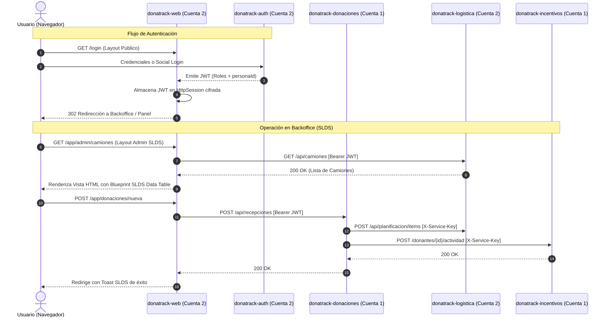

# DonaTrack — Registro de Decisiones de Arquitectura (ADR)
## Entrega 6: Cliente Liviano (SSR), Arquitectura Distribuida y Seguridad

---

## 1. Contexto y Objetivos

Para la **Entrega 6** del proyecto **DonaTrack** (*Interfaz de Usuario y Arquitectura MVC*), el sistema transiciona de un esquema de backend orientado puramente a APIs REST hacia un ecosistema distribuido completo que provee:
1. Una interfaz de usuario accesible, responsive y usable bajo las heurísticas de Nielsen y normas WCAG 2.1 AA.
2. Un cliente liviano desacoplado basado en Renderizado del Lado del Servidor (SSR) con Spring Boot y **Thymeleaf**.
3. Un servicio dedicado de Autenticación (`donatrack-auth`) con soporte para Single Sign-On (SSO / Social Login con Google y GitHub) y emisión de JSON Web Tokens (JWT).
4. Un despliegue optimizado y particionado en dos cuentas de **Render** para balancear límites de recursos (Free Tier) y desacoplar la capa de interacción de la capa de procesamiento de datos pesada.

---

## 2. Decisiones Arquitectónicas Formales

### ADR-01: Desacoplamiento del Cliente Liviano (`donatrack-web`)

- **Estado:** Aceptado.
- **Contexto:** Inicialmente el repositorio contaba con un módulo agregador (`donatrack-server`) que agrupaba todos los microservicios en un único artefacto ejecutable.
- **Decisión:** Se crea un microservicio dedicado e independiente denominado `donatrack-web`. Este módulo:
  - **No** incluye dependencias Maven a los módulos de dominio de negocio (`donatrack-donaciones`, `donatrack-logistica`, etc.) ni a drivers de base de datos relacionales/documentales.
  - Actúa estrictamente como **BFF (Backend-For-Frontend) / Cliente Liviano SSR**.
  - Consume las APIs REST remotas y locales utilizando el cliente síncrono moderno `RestClient` de Spring Boot 3.5.
- **Consecuencias Positivas:**
  - El artefacto Docker resultante es sumamente liviano (arranque rápido y bajo consumo de memoria RAM en Render).
  - Aislamiento estricto de responsabilidades: los cambios en la UI o en los controladores web no impactan en la compilación ni estabilidad de los servicios de negocio.

---

### ADR-02: Estrategia Dual de UI y Aislamiento Estricto de Layouts

- **Estado:** Aceptado.
- **Contexto:** La plataforma requiere dos experiencias de usuario radicalmente distintas:
  1. *Pública:* Portal de donaciones, historia visual de impacto, catálogo de necesidades, ranking y landing institucional accesible a donantes y público general.
  2. *Administrativa (Backoffice):* Gestión operativa de flotas de camiones, logística de envíos, asignación por matchmaking, auditoría de vencimientos y carga masiva.
- **Decisión:** Implementar dos layouts de Thymeleaf 100% aislados a nivel CSS y componentes:
  - **`layout-public.html` (Experiencia Pública / E-Commerce):**
    - Enfoque visual moderno, dinámico y amigable.
    - Carga únicamente las hojas de estilo personalizadas (`variables.css`, `base.css`, `components.css`, `sections.css`).
    - **Prohibición estricta de cargar Salesforce Lightning Design System (SLDS):** Evita la sobreescritura de estilos globales (`html`, `body`, tipografía base) y el sangrado de estilos.
    - Incluye la pantalla de **Login y Registro** dentro de este entorno para maximizar la conversión y la estética visual moderna.
  - **`layout-admin.html` (Backoffice Administrativo - SLDS Puro):**
    - Uso estricto de **Salesforce Lightning Design System (SLDS 2.30.3)** oficial.
    - **Regla de oro:** No inventar clases CSS personalizadas ni prefijos `dt-*` sobre componentes nativos de SLDS. Se utilizan directamente los **HTML Blueprints oficiales** para:
      - Global Header y Navbar (`slds-global-header`).
      - Navegación lateral por rol (`slds-nav-vertical`).
      - Encabezados de página (`slds-page-header`).
      - Tablas de datos de alta densidad (`slds-table`, `slds-table_bordered`).
      - Modales accesibles (`slds-modal`, `slds-backdrop`).
      - Notificaciones y alertas contextuales (`slds-notify_toast`).
    - Única excepción permitida: hoja de estilos para la librería de mapas Leaflet (`leaflet.css`).
- **Consecuencias Positivas:** Garantiza consistencia corporativa en el backoffice sin limitar la flexibilidad y calidez visual de la web pública.

---

### ADR-03: Esquema de Autenticación Centralizada, JWT y SSO

- **Estado:** Aceptado.
- **Contexto:** Se requiere autenticación segura, soporte para roles (`ADMIN`, `DONANTE`, `BENEFICIARIA`), integración de Social Login (Google y GitHub) y consumo seguro de las APIs de negocio.
- **Decisión:**
  1. **Servicio Central `donatrack-auth`:**
     - Maneja el repositorio de credenciales de usuario y el intercambio OAuth2 con proveedores externos.
     - Expone endpoints:
       - `POST /auth/login`: Autenticación tradicional mediante usuario y contraseña.
       - `POST /auth/token/exchange`: Intercambio de códigos temporales de un solo uso emitidos tras el flujo de Social Login hacia el cliente web.
       - `GET /auth/me`: Verificación de identidad y roles del token activo.
  2. **Firma Simétrica HS256 (HMAC-SHA256):**
     - Se opta por una clave simétrica compartida (`JWT_SECRET` $\ge$ 256 bits) distribuida vía variables de entorno a todos los microservicios.
     - **Justificación técnica:** Evita llamadas de red síncronas en tiempo de ejecución para descarga de claves públicas (JWKS endpoint) hacia `donatrack-auth`, mitigando fallos por cold-start o límites de tiempo de espera en instancias Free Tier de Render.
  3. **Seguridad de Sesión y Almacenamiento:**
     - El cliente Thymeleaf (`donatrack-web`) retiene el JWT dentro de la `HttpSession` del servidor (almacenado en memoria o repositorio seguro).
     - La comunicación navegador-servidor se gestiona a través de una cookie estándar de sesión `JSESSIONID` marcada con flags `HttpOnly`, `SameSite=Lax` y `Secure` (en producción).
     - El token JWT **nunca** se expone en el LocalStorage ni en scripts accesibles por JavaScript del navegador, erradicando vectores de ataque XSS para el token.
  4. **Seguridad Inter-Servicios (Broker Feign ACL):**
     - Para las llamadas directas máquina-a-máquina (ej. Donaciones consultando Logística o Incentivos notificando Donaciones), se incorpora la cabecera `X-Service-Key` validada por `ServiceKeyFilter` mediante un secreto de infraestructura (`INTERNAL_API_KEY`).
  5. **Rollout Gradual con Flag de Seguridad:**
     - Cada microservicio incorpora la propiedad `donatrack.security.enabled=${DONATRACK_SECURITY_ENABLED:false}`. Esto permite verificar primero la conectividad y luego activar la obligatoriedad del Bearer token de forma segura sin interrumpir las pruebas existentes en Bruno.

---

### ADR-04: Estrategia de Despliegue Distribuido en Render y SaaS Externos

- **Estado:** Aceptado.
- **Contexto:** El despliegue de múltiples microservicios en una única cuenta de Render colapsa los límites de memoria y horas activas del plan gratuito.
- **Decisión:**
  - **Partición en Dos Cuentas de Cómputo (Render):**
    - **Cuenta 1 (Compañero):** Aloja el procesamiento intensivo y el núcleo de datos del negocio:
      - `donatrack-donaciones` (Puerto 8000)
      - `donatrack-incentivos` (Puerto 8001)
      - `donatrack-notificaciones` (Puerto 8003)
    - **Cuenta 2 (Nuestra):** Aloja la capa de interacción, seguridad y logística:
      - `donatrack-web` (Cliente Liviano SSR Thymeleaf, Puerto 8080)
      - `donatrack-auth` (Servidor de Identidad y JWT, Puerto 8004)
      - `donatrack-logistica` (Servicio Logístico único activo, Puerto 8002)
  - **Unificación de Instancia de Logística:** Se apaga la réplica redundante de Logística en la Cuenta 1; la instancia de la Cuenta 2 asume la titularidad oficial de toda la gestión de rutas, camiones y choferes.
  - **Aislamiento de Bases de Datos SaaS:** Las bases de datos persisten en servicios externos dedicados y no en contenedores efímeros de Render:
    - **PostgreSQL:** Instancia administrada en **Supabase** (schemas `donaciones`, `logistica`, `incentivos`, `notificaciones` y nuevo schema `auth`).
    - **MongoDB:** Cluster administrado en **MongoDB Atlas** (base `donatrack_logistica`).
    - **RabbitMQ:** Broker administrado en la nube con **CloudAMQP**.
    - **Automatización & Webhooks:** Instancia de **n8n**.
- **Consecuencias Positivas:** Se optimiza el uso de CPU/RAM de Render, cada servicio escala o reinicia de forma independiente, y la capa de datos permanece inmutable y compartida sin importar qué instancia se suspenda.

---

## 3. Matriz de Variables de Entorno y Conectividad

| Servicio | Variable | Propósito | Entorno |
| :--- | :--- | :--- | :--- |
| **Todos** | `JWT_SECRET` | Clave secreta compartida (HS256) | Compartido |
| **Todos** | `INTERNAL_API_KEY` | Clave de autenticación inter-servicio (`X-Service-Key`) | Compartido |
| **Todos** | `DONATRACK_SECURITY_ENABLED` | Activa/Desactiva el filtro estricto de JWT (`true`/`false`) | Producción |
| **donatrack-web** | `AUTH_URL` | URL base del microservicio `donatrack-auth` | Cuenta 2 |
| **donatrack-web** | `DONACIONES_URL` | URL base de `donatrack-donaciones` | Cuenta 1 |
| **donatrack-web** | `INCENTIVOS_URL` | URL base de `donatrack-incentivos` | Cuenta 1 |
| **donatrack-web** | `LOGISTICA_URL` | URL base de `donatrack-logistica` | Cuenta 2 |
| **donatrack-web** | `NOTIFICACIONES_URL` | URL base de `donatrack-notificaciones` | Cuenta 1 |
| **donatrack-auth** | `WEB_URL` | URL base del frontend para redirección post-OAuth2 | Cuenta 2 |
| **donatrack-auth** | `GOOGLE_CLIENT_ID` / `_SECRET` | Credenciales de Google OAuth 2.0 | Cuenta 2 |
| **donatrack-auth** | `GITHUB_CLIENT_ID` / `_SECRET` | Credenciales de GitHub OAuth App | Cuenta 2 |
| **donatrack-donaciones**| `LOGISTICA_URL_REMOTA` | Apunta a la instancia única activa de Cuenta 2 | Cuenta 1 |

---

## 4. Diagrama de Flujo de Interacción Distribuida

