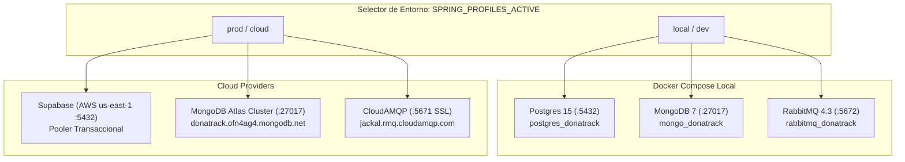

# 📊 Informe Exhaustivo de Estado — Entrega 5 (Persistencia Políglota)

**Materia:** Diseño de Sistemas (K3002) — UTN FRBA  
**Proyecto:** DonaTrack  
**Rama:** `feature/entrega-5-persistencia-poliglota`  
**Estado General:** 🟢 **LISTO PARA DEFENSA Y ENTREGA (98% completitud técnica)**

---

## 🎯 1. Contraste contra la Consigna Oficial (Pág. 25 del PDF)

| Requerimiento Oficial (PDF Pág. 25) | Estado | Detalle de Implementación en DonaTrack |
|---|:---:|---|
| **R1. Persistencia de entidades por servicio** Cada servicio debe persistir su propio modelo en un esquema propio. | ✅ **CUMPLIDO** | Cada microservicio tiene su propio aislamiento de esquema: • `donaciones` (PostgreSQL) • `incentivos` (PostgreSQL) • `notificaciones` (PostgreSQL) • `donatrack_logistica` (MongoDB) |
| **R2. Persistencia Políglota (ORM vs ODM)** Logística en base documental (NoSQL) con ODM; el resto en base relacional con ORM. | ✅ **CUMPLIDO** | • **Logística:** Base documental **MongoDB** usando **Spring Data MongoDB** (`@Document`, `MongoRepository`, Binary UUID converters). Cero acoplamiento a JPA/Hibernate. • **Donaciones / Incentivos / Notificaciones:** **PostgreSQL** usando **Spring Data JPA + Hibernate** (`@Entity`, `@Table(schema=...)`, value objects embebidos). |
| **R3. Estrategia de Desnormalización** Optimización de consultas de lectura frecuentes. | ✅ **CUMPLIDO** | Aggregate Root `rutas_reparto` en MongoDB: 1. **Paradas y entregas embebidas** en un único documento BSON (lectura de hoja de ruta en $O(1)$ sin joins). 2. **Snapshot histórico inmutable** de datos del camión (patente, capacidad) y chofer (legajo, nombre) al momento del despacho, inmune a modificaciones posteriores. |

---

## ☁️ 2. Estado de Entornos: Local (Docker) vs Cloud (Prod)

El sistema soporta alternancia instantánea mediante la variable `SPRING_PROFILES_ACTIVE`:

### Resultados de Conectividad Verificados en Vivo

1. **PostgreSQL Relacional:**
   - **Local (Docker):** ✅ **CONECTADO** — Contenedor `postgres_donatrack` activo, esquemas `donaciones`, `incentivos`, `notificaciones` creados con sus tablas.
   - **Cloud (Supabase):** ✅ **CONECTADO** — Test de conexión ejecutado contra `aws-1-us-east-1.pooler.supabase.com:5432` con usuario `postgres`. Se validaron los 4 esquemas existentes.
2. **RabbitMQ Broker de Mensajería:**
   - **Local (Docker):** ✅ **CONECTADO** — Contenedor `rabbitmq_donatrack` escuchando en `5672` (AMQP) y `15672` (Management), usuario `donatrack`, vhost `/`.
   - **Cloud (CloudAMQP):** ✅ **CONECTADO** — Test TLS ejecutado con éxito contra `jackal.rmq.cloudamqp.com:5671` (vhost `tekhkcyy`, RabbitMQ v4.3.6).
3. **MongoDB Documental:**
   - **Local (Docker):** ✅ **CONECTADO Y POBLADO** — Contenedor `mongo_donatrack` con 6 camiones, 6 choferes, 6 ítems de planificación y rutas precargadas con comprobantes fotográficos.
   - **Cloud (MongoDB Atlas):** ⚠️ **ACCIÓN REQUERIDA (IP Whitelist)**:
     - El cluster `donatrack.ofn4ag4.mongodb.net` y usuario `mfernandezcruz_db_user` están configurados en `application-prod.properties`.
     - Al conectar desde tu red actual (`181.99.147.98`), Atlas rechaza el handshake TLS (`SSLException: Received fatal alert: internal_error (80)`).
     - **Solución requerida en Atlas:** Ingresar a [cloud.mongodb.com](https://cloud.mongodb.com) -> *Security* -> *Network Access* y agregar tu IP actual `181.99.147.98/32` (o temporalmente `0.0.0.0/0` para permitir acceso desde cualquier red en la defensa).

---

## 🧪 3. Verificación de Código, Tests y Flujo E2E

### A. Test Suite Automatizado (`mvn test`)
* **Resultado:** ✅ **100% BUILD SUCCESS** en los 8 módulos del reactor:
  - `donatrack-common`: SUCCESS
  - `donatrack-donaciones`: SUCCESS
  - `donatrack-logistica`: SUCCESS (26 tests pasando: mappers BSON, repositorios ODM y agregados de ruta)
  - `donatrack-incentivos`: SUCCESS
  - `donatrack-notificaciones`: SUCCESS
  - `donatrack-auth`: SUCCESS
  - `donatrack-server`: SUCCESS (Se resolvió la configuración de slice de test agregando `@Profile("!test")` a `MongoDataInitializer`).

### B. Flujo Transaccional e Integración Asíncrona (RabbitMQ + Postgres + Mongo)
Se ejecutó la prueba de integración de ciclo de vida completo (`test_flow.py`):
1. **Recepción:** Donación creada en PostgreSQL (`/api/recepciones`).
2. **Despacho a Logística:** Donación enviada a MongoDB (`/api/planificacion/items`).
3. **Planificación de Rutas:** Algoritmo en Logística agrupa paradas y genera ruta en MongoDB (`/api/planificacion/ejecutar`).
4. **Inicio de Ruta:** Chofer inicia ruta (`/api/rutas/{id}/iniciar`) -> Logística publica `RutaIniciadaEvent` en RabbitMQ -> Donaciones lo consume y transiciona la donación a `EN_TRASLADO` en PostgreSQL.
5. **Confirmación de Entrega:** Se registran fotos del remito (`/api/entregas/{id}/confirmar`) en MongoDB -> Logística publica `EntregaRealizadaEvent` en RabbitMQ -> Donaciones lo consume y transiciona la donación a `ENTREGADA` en PostgreSQL.

### C. Colección de Bruno (`docs/donatrack-api/Donatrack - API/`)
* **Resultado CLI (`npx @usebruno/cli run --env dev`):** ✅ **52 de 52 requests ejecutadas exitosamente**.

---

## 📐 4. Entregables y Diagramas de Arquitectura

1. **Modelo de Dominio y Datos (E1):**
   - [`DC-Donaciones-Entrega5.puml`](file:///c:/Users/asus/OneDrive/Escritorio/FACULTAD%20MAX/DonaTrack/diagramas/donaciones/DC-Donaciones-Entrega5.puml): Refleja la arquitectura hexagonal, casos de uso transaccionales, Value Objects aplanados (`Contacto`, `Coordenada`, `DocumentoIdentidad`) y herencias JPA.
   - [`DER-Logistica.puml`](file:///c:/Users/asus/OneDrive/Escritorio/FACULTAD%20MAX/DonaTrack/diagramas/logistica/DER-Logistica.puml): Modela la base documental NoSQL con colecciones `camiones`, `choferes`, `items_planificacion`, `rutas_reparto` (con paradas/entregas embebidas) e índices multikey.
2. **Diagrama de Componentes y Despliegue (E2 / E3):**
   - [`DonaTrack-Diagrama-Componentes-y-Despliegue.puml`](file:///c:/Users/asus/OneDrive/Escritorio/FACULTAD%20MAX/DonaTrack/diagramas/DonaTrack-Diagrama-Componentes-y-Despliegue.puml): Documenta los microservicios con sus puertos, colas RabbitMQ y el dual deployment (Local Docker vs Prod Cloud).
3. **Justificaciones de Diseño (E2):**
   - [`Justificación Decisiones - DonaTrack - Grupo 7.xlsx`](file:///c:/Users/asus/OneDrive/Escritorio/FACULTAD%20MAX/DonaTrack/docs/Justificaci%C3%B3n%20Decisiones%20-%20DonaTrack%20-%20Grupo%207.xlsx): Matriz oficial con las decisiones de E3, E4 y las 10 decisiones de E5.
   - [`_notas_y_borradores/arquitectura.md`](file:///c:/Users/asus/OneDrive/Escritorio/FACULTAD%20MAX/DonaTrack/_notas_y_borradores/arquitectura.md): Fundamentación teórica completa de persistencia políglota, ODM vs ORM, trade-offs de desnormalización y acotamiento de documentos BSON (límite de 16 MB).

---

## 📋 5. ¿Qué falta exactamente para cerrar la entrega al 100%?

De acuerdo con [`plan_implementacion_entrega5.md`](file:///c:/Users/asus/OneDrive/Escritorio/FACULTAD%20MAX/DonaTrack/_notas_y_borradores/pendientes/plan_implementacion_entrega5.md):

1. **Whitelisting en MongoDB Atlas:**
   - Agregar la IP actual `181.99.147.98` o `0.0.0.0/0` en la consola de Atlas para probar la conexión a la nube de MongoDB.
2. **Auditoría visual en Lucidchart (Tarea administrativa):**
   - Verificar que las pestañas en el documento oficial de [Lucidchart](https://lucid.app/lucidchart/9c714d54-d357-4b30-bec0-bf22dbca2003/edit) coincidan con los `.puml` generados.
3. **Commit & Push en Git:**
   - Comitear los archivos modificados en `feature/entrega-5-persistencia-poliglota` (ajustes de `application-prod.properties`, `.env.template`, `MongoDataInitializer.java` y `ConfirmarRecepcionYNotificarUseCase.java`).

