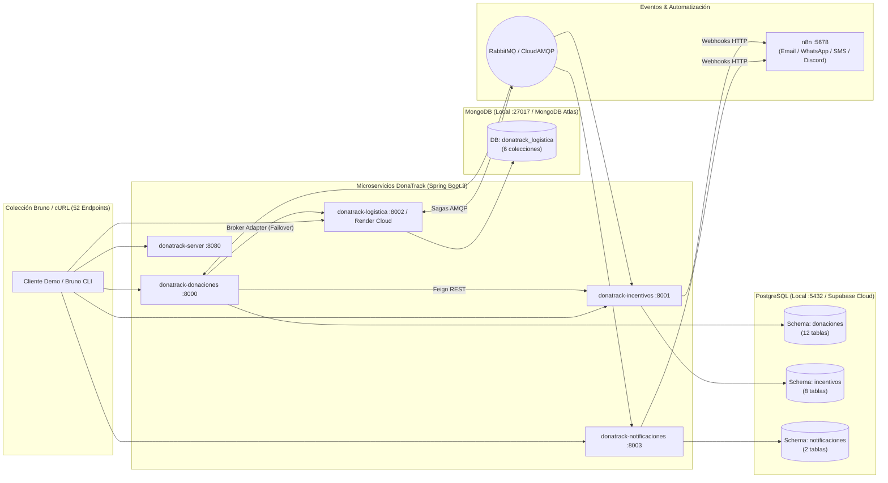
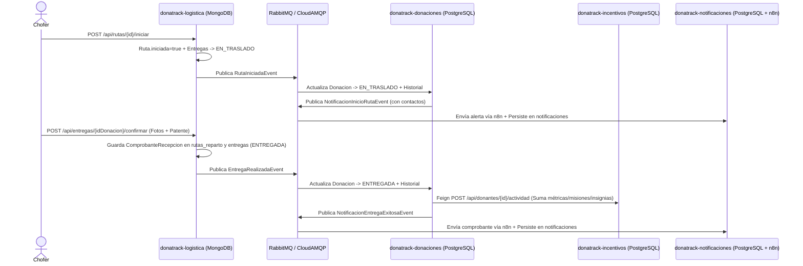

# 🚀 DonaTrack — Guía de Demo Paso a Paso (End-to-End & Persistencia Políglota)

Esta guía interactiva está diseñada para ejecutar una **demostración en vivo de punta a punta** de **DonaTrack**, validando tanto los **52 endpoints de la colección de Bruno** como la **persistencia políglota real** en **PostgreSQL** (`donaciones`, `incentivos`, `notificaciones`) y **MongoDB** (`donatrack_logistica`), junto con la mensajería asincrónica en **RabbitMQ / CloudAMQP** y las automatizaciones en **n8n / Discord**.

---

## 🗺️ Arquitectura en Acción durante la Demo



---

## ⚡ 0. Puesta en Marcha y Validación Automática de los 52 Endpoints (Bruno CLI)

### Opción A — Entorno Local (`dev` con Docker Compose)

```bash
# 1. Levantar toda la infraestructura y microservicios locales
docker compose --profile local up -d

# 2. Inicializar/sincronizar esquemas y datos semilla en PostgreSQL y MongoDB
make db-init

# 3. Ejecutar los 52 endpoints de la colección Bruno contra el entorno local (dev)
cd "docs/donatrack-api/Donatrack - API"
npx @usebruno/cli run --env dev
cd ../../..
```

### Opción B — Entorno Cloud Híbrido (`prod` con Supabase + MongoDB Atlas + CloudAMQP + Render)

> [!TIP]
> En el entorno `prod`, el pre-request script de `opencollection.yml` y el `LogisticaBrokerAdapter` detectan automáticamente la instancia activa de **Logística en Render** (`https://dona-logistica.onrender.com`), mientras que los servicios locales con `SPRING_PROFILES_ACTIVE=prod` persisten directamente en **Supabase PostgreSQL**, **MongoDB Atlas** y **CloudAMQP**.

```bash
# Ejecutar la suite completa apuntando al entorno productivo (prod)
cd "docs/donatrack-api/Donatrack - API"
npx @usebruno/cli run --env prod
cd ../../..
```

---

## 🧑‍🤝‍🧑 Flujo 1: Gestión de Personas, Importación CSV y Necesidades de Beneficiarios
**Módulo:** `donatrack-donaciones` (`:8000`) | **Base de Datos:** PostgreSQL (`schema: donaciones`)  
**Requerimiento del Enunciado:** Alta de donantes (personas humanas y jurídicas), carga masiva por CSV, registro de organizaciones beneficiarias y declaración de necesidades (recurrentes y extraordinarias).

### Paso 1.1 — Crear un nuevo Donante (`POST /api/personas`)
*(Equivalente en Bruno: `Donaciones/Personas/Crear Persona`)*

```bash
curl -s -X POST http://localhost:8000/api/personas \
  -H "Content-Type: application/json" \
  -d '{
    "tipo": "HUMANA",
    "email": "mateo.demo@donatrack.com",
    "nombre": "Mateo",
    "apellido": "Fernandez",
    "edad": 23,
    "contacto": {
      "correoElectronico": "mateo.demo@donatrack.com",
      "telefono": "+54 11 1234-5678",
      "whatsapp": "+54 11 1234-5678",
      "medioPredeterminado": "CORREO"
    },
    "documento": {
      "tipo": "DNI",
      "numero": "99887766"
    },
    "direccion": {
      "calle": "Av. Corrientes",
      "altura": 4303,
      "localidad": "CABA",
      "provincia": {
        "nombreProvincia": "Buenos Aires",
        "pais": { "nombre": "Argentina" }
      },
      "codigoPostal": "C1181",
      "coordenadas": null
    }
  }' | jq .
```

### Paso 1.2 — Importar Donantes Masivamente desde CSV (`POST /api/personas/importar-csv`)
*(Equivalente en Bruno: `Donaciones/Personas/Importar CSV`)*

```bash
curl -s -X POST http://localhost:8000/api/personas/importar-csv \
  -F "file=@docs/donatrack-api/Donatrack - API/Donaciones/Personas/donantes_sample.csv"
echo ""
```

### Paso 1.3 — Declarar una Necesidad Extraordinaria en una Entidad Beneficiaria (`POST /api/beneficiarios/{id}/necesidades`)
*(Equivalente en Bruno: `Donaciones/Beneficiarios/Agregar Necesidad`)*

```bash
curl -i -s -X POST http://localhost:8000/api/beneficiarios/b2222222-2222-4222-8222-222222222222/necesidades \
  -H "Content-Type: application/json" \
  -d '{
    "tipo": "extraordinaria",
    "descripcion": "Leche larga vida para merendero barrial",
    "cantidadRequerida": 120.0,
    "subcategoriaRequerida": {
      "nombre": "No Perecederos",
      "descripcion": "Alimentos no perecederos"
    }
  }' | head -n 5
```

### 🔍 Verificación de Persistencia en PostgreSQL (`schema: donaciones`)

```bash
docker exec postgres_donatrack psql -U postgres -d donatrack -c "
SELECT p.persona_id, p.email, ph.nombre, ph.apellido, pj.razon_social, r.dtype AS rol
FROM donaciones.personas p
LEFT JOIN donaciones.personas_humanas ph ON ph.persona_humana_id = p.persona_id
LEFT JOIN donaciones.personas_juridicas pj ON pj.persona_juridica_id = p.persona_id
LEFT JOIN donaciones.roles r ON r.persona_id = p.persona_id
ORDER BY p.email LIMIT 10;
"

docker exec postgres_donatrack psql -U postgres -d donatrack -c "
SELECT n.necesidad_id, n.dtype, s.nombre AS subcategoria, n.descripcion, n.estado, n.cantidad_requerida, n.cantidad_objetivo
FROM donaciones.necesidades n
LEFT JOIN donaciones.subcategorias s ON s.subcategoria_id = n.subcategoria_id;
"
```

---

## 📦 Flujo 2: Recepción de Bienes Brutos, Segmentación Automática, Matchmaking y Asignación
**Módulos:** `donatrack-donaciones` (`:8000`) ➔ `donatrack-incentivos` (`:8001`) + `donatrack-logistica` (`:8002`) + `donatrack-notificaciones` (`:8003`)  
**Requerimiento del Enunciado:** Al recibir bienes heterogéneos en depósito, el sistema genera un `DonacionOriginal` y lo **segmenta automáticamente** en objetos `Donacion` por subcategoría, registrando su `HistorialEstado`, sugiriendo beneficiarios mediante `MatchmakerService` y enviando el pedido de retiro a Logística al asignarse.

### Paso 2.1 — Recibir Bienes Brutos y Segmentar (`POST /api/recepciones`)
*(Equivalente en Bruno: `Donaciones/Crear Donacion`)*

```bash
curl -s -X POST http://localhost:8000/api/recepciones \
  -H "Content-Type: application/json" \
  -d '{
    "idDonante": "a1111111-1111-4111-8111-111111111111",
    "idAdministrador": "a2222222-2222-4222-8222-222222222222",
    "bienesBrutos": [
      {
        "descripcion": "Paquete de arroz 1kg",
        "cantidad": 10.0,
        "unidadMedicion": "KILOS",
        "esUsado": false,
        "fechaVencimiento": "2027-06-01",
        "nombreSubcategoria": "No Perecederos"
      },
      {
        "descripcion": "Campera de abrigo térmica",
        "cantidad": 4.0,
        "unidadMedicion": "UNIDADES",
        "esUsado": true,
        "fechaVencimiento": null,
        "nombreSubcategoria": "Abrigo"
      }
    ]
  }' | jq .
```

### Paso 2.2 — Sugerir Beneficiarios con Matchmaking (`GET /api/donaciones/{id}/matchmaking`)
*(Equivalente en Bruno: `Donaciones/Sugerir Beneficiarios`)*

```bash
curl -s http://localhost:8000/api/donaciones/5cd80011-2a54-4ca7-a39c-28b2b53d8c55/matchmaking | jq .
```

### Paso 2.3 — Asignar Donación a Beneficiario (`PUT /api/donaciones/{id}/estado/asignar`)
*(Equivalente en Bruno: `Donaciones/Asignar Donacion`)*  
Esto cambia la donación a `ASIGNADA`, persiste la transición en `donaciones.historial_estado`, envía el ítem a `donatrack-logistica` (`items_planificacion` en MongoDB) y dispara las notificaciones por RabbitMQ/n8n.

```bash
curl -i -s -X PUT http://localhost:8000/api/donaciones/5cd80011-2a54-4ca7-a39c-28b2b53d8c55/estado/asignar \
  -H "Content-Type: application/json" \
  -d '{
    "id": "e4444444-4444-4444-8444-444444444444"
  }' | head -n 5

# Verificar el nuevo estado y beneficiario asignado por API
curl -s http://localhost:8000/api/donaciones/5cd80011-2a54-4ca7-a39c-28b2b53d8c55 | jq .
```

### 🔍 Verificación de Trazabilidad e Historial en PostgreSQL (`donaciones.donaciones` & `historial_estado`)

```bash
docker exec postgres_donatrack psql -U postgres -d donatrack -c "
SELECT d.donacion_id, s.nombre AS subcategoria, d.estado, d.necesidad_id, d.fecha_creacion
FROM donaciones.donaciones d
LEFT JOIN donaciones.subcategorias s ON s.subcategoria_id = d.subcategoria_id
ORDER BY d.fecha_creacion DESC LIMIT 6;
"

docker exec postgres_donatrack psql -U postgres -d donatrack -c "
SELECT donacion_id, estado, fecha, observacion, usuario_id
FROM donaciones.historial_estado
ORDER BY fecha DESC LIMIT 8;
"
```

---

## 🚚 Flujo 3: Logística NoSQL (MongoDB) y Saga Completa por RabbitMQ
**Módulo:** `donatrack-logistica` (`:8002` en Local / `https://dona-logistica.onrender.com` en Cloud) | **Base de Datos:** MongoDB (`donatrack_logistica`)  
**Requerimiento del Enunciado:** Persistencia NoSQL orientada a documentos de las **6 colecciones** (`camiones`, `choferes`, `items_planificacion`, `solicitudes_planificacion`, `rutas_reparto`, `entregas`), inicio de hoja de ruta, confirmación de entrega con remito fotográfico y reporte de entrega fallida con replanificación.



### Paso 3.1 — Ejecutar Planificación y Recibir Callback del Optimizador de Rutas
*(Equivalentes en Bruno: `Logistica/Recepcionar Donacion`, `Logistica/Ejecutar Planificacion`, `Logistica/Callback Planificacion`)*

```bash
# 1. Ingresar un ítem de planificación en la bandeja de salida de Logística
curl -i -s -X POST http://localhost:8002/api/planificacion/items \
  -H "Content-Type: application/json" \
  -d '{
    "idDonacion": "139e0f9f-9431-4302-9f06-cad97978f7be",
    "peso": 25.5,
    "volumen": 0.5,
    "calleDestino": "Av. Santa Fe",
    "alturaDestino": "1234",
    "localidadDestino": "CABA"
  }' | head -n 5

# 2. Recibir el callback con la hoja de ruta optimizada (Camión AE304KL, Chofer CH-105)
curl -i -s -X POST http://localhost:8002/api/planificacion/callback \
  -H "Content-Type: application/json" \
  -d '{
    "idSolicitud": "b4444444-4444-4444-8444-444444444444",
    "rutas": [
      {
        "id": "a1b2c3d4-e5f6-7890-abcd-ef1234567890",
        "fechaOperativa": "2026-10-29",
        "camion": { "patente": "AE304KL" },
        "chofer": { "legajo": "CH-105" },
        "paradas": [
          {
            "orden": 1,
            "direccion": { "calle": "Av. Corrientes", "altura": "1234", "localidad": "CABA" },
            "coordenada": { "latitud": -34.6037, "longitud": -58.3816 },
            "entregas": [
              {
                "idEntrega": "139e0f9f-9431-4302-9f06-cad97978f7be",
                "pesoEstimado": 25.5,
                "volumenEstimado": 0.5
              }
            ]
          }
        ]
      }
    ]
  }' | head -n 5
```

### Paso 3.2 — Iniciar Hoja de Ruta (`POST /api/rutas/{id}/iniciar`)
*(Equivalente en Bruno: `Logistica/Iniciar Ruta`)*

```bash
curl -s -X POST http://localhost:8002/api/rutas/a1b2c3d4-e5f6-7890-abcd-ef1234567890/iniciar \
  -H "Content-Type: application/json" \
  -d '{
    "legajoChofer": "CH-105"
  }'
echo ""
```

### Paso 3.3 — Confirmar Entrega con Comprobante Fotográfico (`POST /api/entregas/{idDonacion}/confirmar`)
*(Equivalente en Bruno: `Logistica/Confirmar Entrega`)*

```bash
curl -s -X POST http://localhost:8002/api/entregas/139e0f9f-9431-4302-9f06-cad97978f7be/confirmar \
  -H "Content-Type: application/json" \
  -d '{
    "fotos": [
      "https://fotos.donatrack.org/remito-1.jpg"
    ],
    "patenteCamion": "AE304KL"
  }'
echo ""
```

### Paso 3.4 — Reportar Falla de Entrega y Disparar Replanificación (`POST /api/entregas/{idDonacion}/falla`)
*(Equivalente en Bruno: `Logistica/Reportar Falla`)*

```bash
curl -s -X POST http://localhost:8002/api/entregas/35008064-071a-4d7a-ac37-33318f7d9845/falla \
  -H "Content-Type: application/json" \
  -d '{
    "motivo": "El beneficiario no se encontraba en el domicilio",
    "puedeReplanificarse": true
  }'
echo ""
```

### 🔍 Verificación de Persistencia Políglota (MongoDB + Efecto Dominó en PostgreSQL)

```bash
# 1. Verificar en MongoDB las 6 colecciones y el comprobante de recepción persistido
docker exec mongo_donatrack mongosh -u donatrack -p donatrack --authenticationDatabase admin donatrack_logistica --quiet --eval '
  print("=== Conteo por Colección en donatrack_logistica ===");
  ["camiones", "choferes", "items_planificacion", "entregas", "solicitudes_planificacion", "rutas_reparto"].forEach(c => {
    print(c + ": " + db.getCollection(c).countDocuments());
  });
  print("\n=== Entrega Confirmada (139e0f9f-...) con Remito ===");
  printjson(db.entregas.findOne({ _id: UUID("139e0f9f-9431-4302-9f06-cad97978f7be") }));
  print("\n=== Entrega Fallida (35008064-...) Marcada NO_RECIBIDA ===");
  printjson(db.entregas.findOne({ _id: UUID("35008064-071a-4d7a-ac37-33318f7d9845") }));
'

# 2. Verificar en PostgreSQL cómo RabbitMQ actualizó automáticamente las donaciones y su historial
docker exec postgres_donatrack psql -U postgres -d donatrack -c "
SELECT donacion_id, estado, fecha, observacion
FROM donaciones.historial_estado
WHERE donacion_id IN ('139e0f9f-9431-4302-9f06-cad97978f7be', '35008064-071a-4d7a-ac37-33318f7d9845')
ORDER BY fecha DESC;
"
```

---

## 🏆 Flujo 4: Gamificación, Misiones, Insignias y Podio Mensual Top 3
**Módulo:** `donatrack-incentivos` (`:8001`) | **Base de Datos:** PostgreSQL (`schema: incentivos`) + **n8n Discord**  
**Requerimiento del Enunciado:** Seguimiento de métricas históricas y rachas del donante, evaluación de misiones según su categoría (`COLABORADOR`, `BRONCE`, `PLATA`, `ORO`), otorgamiento de insignias con difusión automática en redes/Discord vía n8n y cálculo del Ranking Mensual Top 3.

### Paso 4.1 — Registrar Actividad de Donación Exitosa (`POST /api/donantes/{id}/actividad`)
*(Equivalente en Bruno: `Incentivos/Registrar Actividad`)*

```bash
curl -i -s -X POST http://localhost:8001/api/donantes/a1111111-1111-4111-8111-111111111111/actividad \
  -H "Content-Type: application/json" \
  -d '{
    "idDonacion": "31008064-071a-4d7a-ac37-33318f7d9841",
    "cantidadBienes": 5,
    "categorias": ["Alimentos", "Vestimenta"],
    "idEntidadBeneficiaria": "e4b07384-d113-4ec6-a51d-402f06c1af0c",
    "fecha": "2026-10-29"
  }' | head -n 5
```

### Paso 4.2 — Consultar Métricas, Misiones Activas e Insignias del Donante
*(Equivalentes en Bruno: `Incentivos/Obtener Metricas`, `Incentivos/Obtener Misiones`, `Incentivos/Obtener Insignias`)*

```bash
# Métricas acumuladas, racha de meses y organizaciones ayudadas
curl -s http://localhost:8001/api/donantes/a1111111-1111-4111-8111-111111111111/metricas | jq .

# Misión actual en curso
curl -s http://localhost:8001/api/donantes/a1111111-1111-4111-8111-111111111111/misiones | jq .

# Insignias obtenidas (y disparo de difusión a Discord vía n8n)
curl -s http://localhost:8001/api/donantes/a1111111-1111-4111-8111-111111111111/insignias | jq .
```

### Paso 4.3 — Calcular y Persistir el Ranking Mensual Top 3 (`GET /api/ranking/top3`)
*(Equivalente en Bruno: `Incentivos/Obtener Ranking`)*

```bash
curl -s http://localhost:8001/api/ranking/top3 | jq .
```

### 🔍 Verificación de Persistencia en PostgreSQL (`schema: incentivos`)

```bash
docker exec postgres_donatrack psql -U postgres -d donatrack -c "
SELECT p.perfil_donante_id, p.categoria, m.nombre AS mision_actual,
       md.total_donaciones_historicas, md.organizaciones_ayudadas
FROM incentivos.perfiles_donante p
LEFT JOIN incentivos.misiones m ON m.mision_id = p.mision_actual_id
LEFT JOIN incentivos.metricas_donante md ON md.perfil_donante_id = p.perfil_donante_id;
"

docker exec postgres_donatrack psql -U postgres -d donatrack -c "
SELECT io.perfil_donante_id, i.nombre AS insignia, io.fecha_obtencion, io.visible_publicamente
FROM incentivos.insignias_obtenidas io
JOIN incentivos.insignias i ON i.insignia_id = io.insignia_id;
"

docker exec postgres_donatrack psql -U postgres -d donatrack -c "
SELECT r.mes, r.anio, pr.posicion, pr.perfil_donante_id, pr.misiones_completadas_mes
FROM incentivos.rankings_mensuales r
JOIN incentivos.posiciones_ranking pr ON pr.ranking_mensual_id = r.ranking_mensual_id
ORDER BY pr.posicion;
"
```

---

## 🔔 Flujo 5: Notificaciones Multicanal y Auditoría de Eventos (n8n + Discord)
**Módulo:** `donatrack-notificaciones` (`:8003`) + **n8n** (`:5678`) | **Base de Datos:** PostgreSQL (`schema: notificaciones`)  
**Requerimiento del Enunciado:** Despacho multicanal (`CORREO`, `DISCORD`, `WHATSAPP`, `SMS`) desacoplado mediante adaptadores hacia **n8n** y registro de auditoría en `notificaciones.eventos_notificacion` y `notificaciones.notificaciones`.

### Paso 5.1 — Enviar Notificaciones por Correo, Discord, WhatsApp y SMS (`POST /api/mensajes`)
*(Equivalentes en Bruno: `Notificaciones/01..04`)*

```bash
# 1. Correo Electrónico vía n8n
curl -i -s -X POST http://localhost:8003/api/mensajes \
  -H "Content-Type: application/json" \
  -d '{
    "destinatario": "donante@test.com",
    "mensaje": "¡Tu donación está en camino al comedor Los Bajitos!",
    "medio": "CORREO"
  }' | head -n 5

# 2. Publicación en Canal de Discord vía n8n
curl -i -s -X POST http://localhost:8003/api/mensajes \
  -H "Content-Type: application/json" \
  -d '{
    "destinatario": "Canal General Discord",
    "mensaje": "🎉 ¡Nueva donación registrada exitosamente desde la Demo de DonaTrack!",
    "medio": "DISCORD"
  }' | head -n 5
```

### 🔍 Verificación de Persistencia en PostgreSQL (`schema: notificaciones`)

```bash
docker exec postgres_donatrack psql -U postgres -d donatrack -c "
SELECT e.tipo_evento, n.destinatario, n.medio, n.completada, n.fecha_envio, LEFT(n.mensaje, 65) AS mensaje_resumen
FROM notificaciones.notificaciones n
JOIN notificaciones.eventos_notificacion e ON e.evento_notificacion_id = n.evento_notificacion_id
ORDER BY n.fecha_envio DESC LIMIT 10;
"
```

