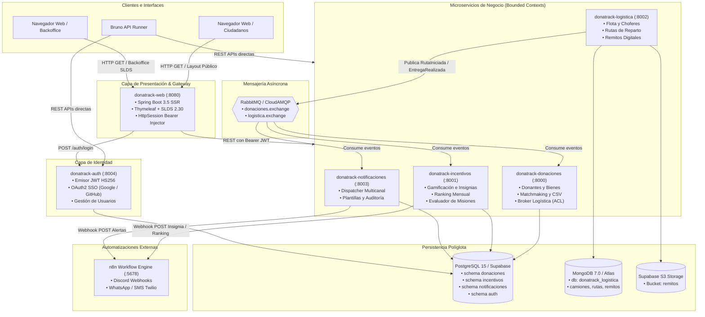
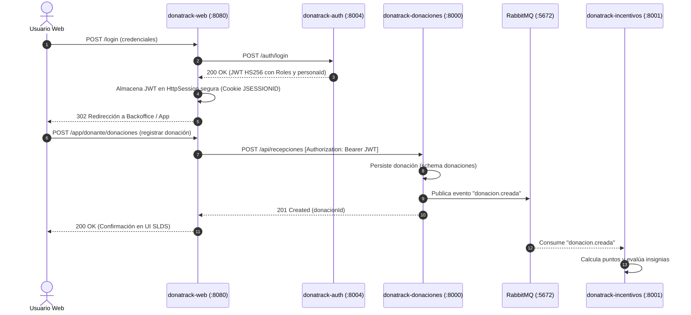
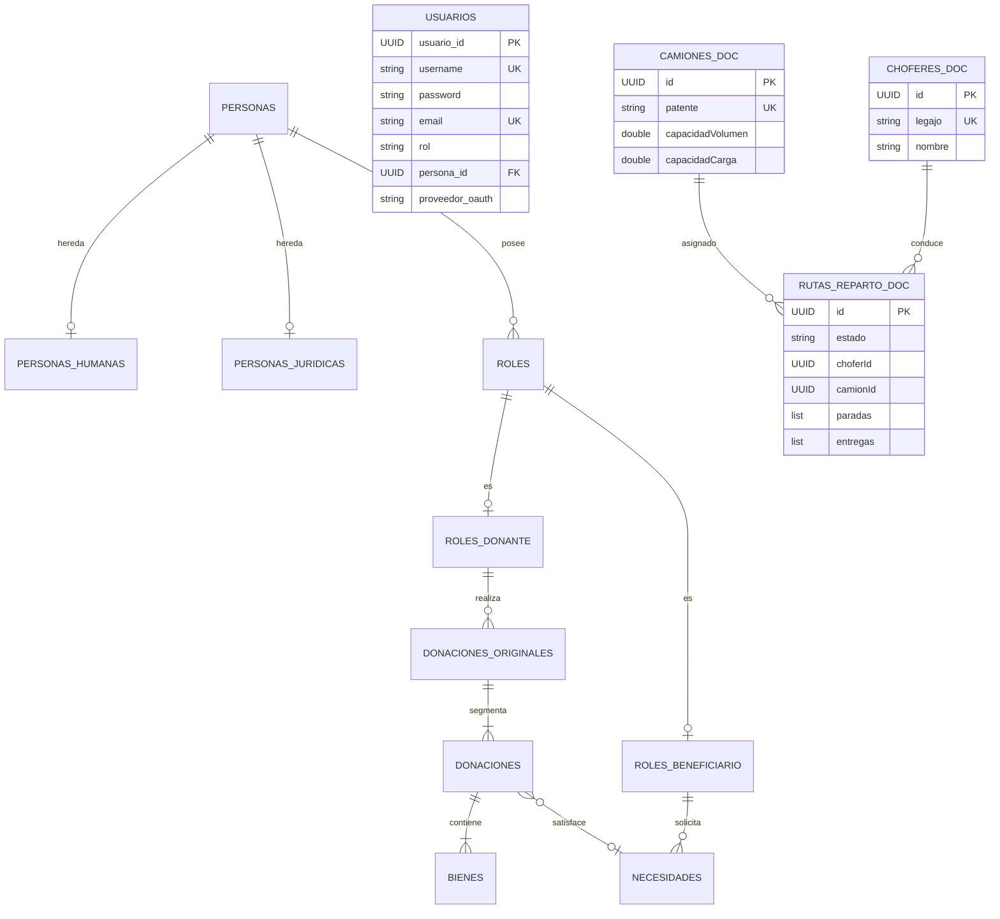
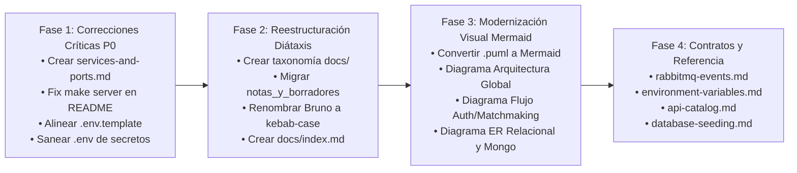

# 📋 Informe de Auditoría Técnica de Documentación — Proyecto DonaTrack

**Squad de Arquitectura — Rol:** Especialista en Documentación Técnica (`doc-specialist`)  
**Fecha:** Noviembre de 2026  
**Estado:** Propuesta formal para revisión y aprobación  
**Alcance:** Repositorio raíz, descriptores Maven (`pom.xml`), Docker Compose (`compose.yaml`), automatización (`n8n/`), variables de entorno y directorio `docs/`.

---

## 1. Resumen Ejecutivo

> La documentación de **DonaTrack** presenta una profunda desincronización entre su código fuente real (arquitectura políglota de 6 microservicios + cliente SSR Thymeleaf) y sus manuales principales, evidenciando enlaces rotos críticos como `SERVICIOS.md`, comandos de compilación inexistentes (`make server`) y diagramas PlantUML desactualizados que omiten la autenticación centralizada y distorsionan la persistencia de Logística (documentada erróneamente en PostgreSQL cuando opera en MongoDB). Para subsanar esta deuda técnica sin alterar código productivo, se propone migrar toda la base documental al marco taxonómico internacional **Diátaxis** (Tutoriales, Guías Prácticas, Referencia y Arquitectura), transformando los modelos PlantUML a **Mermaid nativo** en Markdown y cerrando los vacíos de contratos de mensajería RabbitMQ y variables de entorno.

---

## 2. Auditoría Técnica: Realidad del Código vs. Documentación Existente

A partir de la inspección de los descriptores de build ([`pom.xml`](file:///c:/Users/asus/OneDrive/Escritorio/FACULTAD%20MAX/DonaTrack/pom.xml), submódulos), orquestadores ([`compose.yaml`](file:///c:/Users/asus/OneDrive/Escritorio/FACULTAD%20MAX/DonaTrack/compose.yaml), [`Makefile`](file:///c:/Users/asus/OneDrive/Escritorio/FACULTAD%20MAX/DonaTrack/Makefile)) y configuración de perfiles (`application.properties` / `application.yml`), se contrasta la realidad técnica contra lo documentado:

| Componente / Dimensión | Realidad Técnica en Código | Documentado en `README.md` / `docs/` | Veredicto / Impacto |
| :--- | :--- | :--- | :--- |
| **Microservicios Activos** | 6 servicios independientes: `donatrack-auth` (:8004), `donatrack-donaciones` (:8000), `donatrack-incentivos` (:8001), `donatrack-logistica` (:8002), `donatrack-notificaciones` (:8003) y `donatrack-web` (:8080). | Lista 4 microservicios + "Server / Gateway :8080". `donatrack-auth` está totalmente ausente del diagrama principal de `README.md`. | **Crítico (P0)**: Desinforma sobre el mapa de microservicios y el puerto del servidor de autenticación. |
| **Capa Frontend / Web** | Cliente Liviano SSR con Spring Boot 3.5, Thymeleaf y Spring Security (`donatrack-web`). | PlantUML en `docs/diagramas/` modela un "Frontend SPA" y un "API Gateway" independiente. | **Crítico (P0)**: Modelo de despliegue obsoleto que contradice las decisiones de diseño (ADR-01 y ADR-02). |
| **Persistencia de Logística** | **MongoDB 7.0** (`donatrack_logistica` con 6 colecciones) + Supabase S3 Storage para remitos. | `README.md` afirma: *"PostgreSQL en Supabase: Schema logistica"* y matriz relacional única. | **Crítico (P0)**: Inconsistencia arquitectónica gravísima; confunde el motor de base de datos del servicio. |
| **Schemas PostgreSQL** | 4 schemas lógicos: `donaciones`, `incentivos`, `notificaciones` y `auth` ([`init.sql`](file:///c:/Users/asus/OneDrive/Escritorio/FACULTAD%20MAX/DonaTrack/database/init.sql)). | Documenta schemas `donaciones`, `logistica`, `incentivos`, `notificaciones`. Omite `auth`. | **Crítico (P0)**: Desincronización con la DDL real. |
| **Comandos de Ejecución** | `Makefile` provee `make donaciones`, `make incentivos`, `make logistica`, `make notificaciones`, `make auth`, `make web` (o `make run`). | `README.md` instruye ejecutar `make server` (puerto 8080). No existe tal target en el `Makefile`. | **Crítico (P0)**: El comando de Quick Start falla de forma inmediata. |
| **Archivo Central de Servicios** | No existe en el repositorio raíz ni en subdirectorios. | `README.md` cita en líneas 61 y 268: *"consultá `SERVICIOS.md`"*. | **Crítico (P0)**: Enlace roto a documentación medular. |
| **Plantilla de Entorno** | Existe [`env.template`](file:///c:/Users/asus/OneDrive/Escritorio/FACULTAD%20MAX/DonaTrack/env.template) (renombrada internamente). | Instrucciones en [`.env`](file:///c:/Users/asus/OneDrive/Escritorio/FACULTAD%20MAX/DonaTrack/.env) y [`.gitignore`](file:///c:/Users/asus/OneDrive/Escritorio/FACULTAD%20MAX/DonaTrack/.gitignore) piden `cp .env.example .env`. `.env.example` no existe. | **Crítico (P0)**: Paso 1 del setup inicial roto. |
| **Diagramas de Arquitectura** | Archivos PlantUML `.puml` sin renderizar en Markdown. El diagrama de componentes es de Entrega 5. | GitHub no renderiza `.puml` nativamente; requiere IDEs o plugins de terceros. | **Mayor (P1)**: Fricción alta para revisores y desarrolladores. |
| **DER Físicos** | Mencionados en `README.md` como entregables de Entrega 4 en `docs/diagramas/`. | No existen archivos `DER-Donaciones`, `DER-Logistica`, `DER-Incentivos` ni `DER-Notificaciones`. | **Mayor (P1)**: Enlaces fantasma a artefactos inexistentes. |
| **Ubicación de ADRs y Memoria** | Documentos maduros (`arquitectura.md` y `decisiones-arquitectura.md`). | Almacenados en la carpeta `docs/notas_y_borradores/`. | **Mayor (P1)**: Desmerece la formalidad de especificaciones aprobadas. |

---

## 3. Clasificación de Hallazgos

### 🔴 Bloqueantes (P0): Inconsistencias Críticas e Instrucciones Rotas

1. **Enlace Roto a Archivo Inexistente `SERVICIOS.md`**:
   - **Ubicación:** [`README.md`](file:///c:/Users/asus/OneDrive/Escritorio/FACULTAD%20MAX/DonaTrack/README.md#L61) (L61 y L268).
   - **Impacto:** Se promete al desarrollador una tabla consolidada de puertos, endpoints de Swagger UI y comandos de ejecución, pero el archivo no existe en el repositorio.
2. **Comando de Quick Start Falla (`make server`)**:
   - **Ubicación:** [`README.md`](file:///c:/Users/asus/OneDrive/Escritorio/FACULTAD%20MAX/DonaTrack/README.md#L262).
   - **Impacto:** Al clonar y ejecutar `make server`, Make responde con `make: *** No rule to make target 'server'. Stop.`. El target configurado en [`Makefile`](file:///c:/Users/asus/OneDrive/Escritorio/FACULTAD%20MAX/DonaTrack/Makefile#L83) es `make web` o `make run`.
3. **Desinformación Crítica de Persistencia en Logística**:
   - **Ubicación:** [`README.md`](file:///c:/Users/asus/OneDrive/Escritorio/FACULTAD%20MAX/DonaTrack/README.md#L32-L36) y [`README.md`](file:///c:/Users/asus/OneDrive/Escritorio/FACULTAD%20MAX/DonaTrack/README.md#L74).
   - **Impacto:** Afirma que `donatrack-logistica` corre sobre un schema de PostgreSQL en Supabase. El microservicio real utiliza Spring Data MongoDB conectándose a MongoDB Atlas / local (`donatrack_logistica`) y Supabase S3 Storage para imágenes. Esto confunde las auditorías y las pruebas locales.
4. **Omisión de `donatrack-auth` en la Arquitectura Raíz**:
   - **Ubicación:** [`README.md`](file:///c:/Users/asus/OneDrive/Escritorio/FACULTAD%20MAX/DonaTrack/README.md#L44-L59).
   - **Impacto:** El diagrama general ignora el servidor de autenticación (puerto 8004), responsable de la seguridad perimetral, SSO (Google/GitHub) y emisión de JWT para todo el clúster.
5. **Inconsistencia en Script de Inicialización y Schemas PostgreSQL**:
   - **Ubicación:** [`README.md`](file:///c:/Users/asus/OneDrive/Escritorio/FACULTAD%20MAX/DonaTrack/README.md#L74) vs [`database/init.sql`](file:///c:/Users/asus/OneDrive/Escritorio/FACULTAD%20MAX/DonaTrack/database/init.sql).
   - **Impacto:** `README.md` lista el schema `logistica` en PostgreSQL (el cual no existe en `init.sql`) y omite el schema `auth` (creado en línea 254 de `init.sql`).
6. **Plantilla de Entorno Inexistente (`.env.example`)**:
   - **Ubicación:** [`.env`](file:///c:/Users/asus/OneDrive/Escritorio/FACULTAD%20MAX/DonaTrack/.env#L5) y [`.gitignore`](file:///c:/Users/asus/OneDrive/Escritorio/FACULTAD%20MAX/DonaTrack/.gitignore#L39).
   - **Impacto:** El archivo real en el repositorio es [`env.template`](file:///c:/Users/asus/OneDrive/Escritorio/FACULTAD%20MAX/DonaTrack/env.template). Cualquier comando automatizado o instrucción manual de copia (`cp .env.example .env`) falla de inmediato.
7. **Exposición Crítica de Secretos en Repositorio (`.env`)**:
   - **Ubicación:** [`.env`](file:///c:/Users/asus/OneDrive/Escritorio/FACULTAD%20MAX/DonaTrack/.env).
   - **Impacto:** Aunque `.env` figura en `.gitignore`, el archivo se encuentra presente en el espacio de trabajo con credenciales reales en texto plano (claves de Supabase, connection string completa de MongoDB Atlas con usuario y contraseña, credenciales de CloudAMQP, webhooks vivos de Discord, credenciales de Twilio, Client Secrets de Google y GitHub). Esto representa una severa vulnerabilidad de seguridad operativa.

---

## 3. Mejoras Recomendadas (P1): Gaps de Documentación, Diagramación y Contratos

1. **Desacreditación por Nomenclatura: Carpeta `notas_y_borradores/`**:
   - **Ubicación:** [`docs/notas_y_borradores/`](file:///c:/Users/asus/OneDrive/Escritorio/FACULTAD%20MAX/DonaTrack/docs/notas_y_borradores/).
   - **Problema:** Contiene los dos documentos arquitectónicos más sólidos del proyecto: [`arquitectura.md`](file:///c:/Users/asus/OneDrive/Escritorio/FACULTAD%20MAX/DonaTrack/docs/notas_y_borradores/arquitectura.md) (memoria técnica formal de Entrega 5) y [`decisiones-arquitectura.md`](file:///c:/Users/asus/OneDrive/Escritorio/FACULTAD%20MAX/DonaTrack/docs/notas_y_borradores/decisiones-arquitectura.md) (ADRs formales de Entrega 6). Llamar a esta carpeta "borradores" proyecta informalidad e impide que los evaluadores identifiquen rápidamente la arquitectura oficial.
2. **Ruta Absoluta Local Rota en `arquitectura.md`**:
   - **Ubicación:** [`docs/notas_y_borradores/arquitectura.md`](file:///c:/Users/asus/OneDrive/Escritorio/FACULTAD%20MAX/DonaTrack/docs/notas_y_borradores/arquitectura.md#L296).
   - **Problema:** Enlace hardcodeado a la máquina personal de un desarrollador: `file:///home/maximo/Documentos/Diseño de Sistemas/...`. Inutilizable en Windows o en GitHub.
3. **Diagramas PlantUML Desactualizados y sin Renderizado Nativo**:
   - **Ubicación:** [`docs/diagramas/DonaTrack-Diagrama-Componentes-y-Despliegue.puml`](file:///c:/Users/asus/OneDrive/Escritorio/FACULTAD%20MAX/DonaTrack/docs/diagramas/DonaTrack-Diagrama-Componentes-y-Despliegue.puml).
   - **Problema:** Describe una arquitectura obsoleta de Entrega 5 (Frontend SPA ficticio, API Gateway inexistente, 2 instancias redundantes de Logística en Render que fueron unificadas según ADR-04, ausencia total de Auth). Además, los archivos `.puml` no se previsualizan en GitHub Markdown sin tooling externo.
4. **Ghost Links a Diagramas DER Inexistentes**:
   - **Ubicación:** [`README.md`](file:///c:/Users/asus/OneDrive/Escritorio/FACULTAD%20MAX/DonaTrack/README.md#L223).
   - **Problema:** Cita `DER-Donaciones`, `DER-Logistica`, `DER-Incentivos` y `DER-Notificaciones` en `docs/diagramas/`, pero ninguno de esos archivos fue commiteado.
5. **Vacío Absoluto de Especificación de Mensajería Asíncrona (RabbitMQ)**:
   - **Problema:** No existe ningún documento o tabla que formalice los nombres de Topic Exchanges (`donaciones.exchange`, `logistica.exchange`), colas durables, routing keys (`entrega.realizada`, `ruta.iniciada`, `donacion.creada`) ni los contratos de eventos (JSON schemas para [`EntregaRealizadaEvent`](file:///c:/Users/asus/OneDrive/Escritorio/FACULTAD%20MAX/DonaTrack/donatrack-common/src/main/java/com/donatrack/common/events/EntregaRealizadaEvent.java) y [`RutaIniciadaEvent`](file:///c:/Users/asus/OneDrive/Escritorio/FACULTAD%20MAX/DonaTrack/donatrack-common/src/main/java/com/donatrack/common/events/RutaIniciadaEvent.java)).
6. **Espacios y Caracteres Especiales en Colección de APIs Bruno**:
   - **Ubicación:** `docs/donatrack-api/Donatrack - API/`.
   - **Problema:** La carpeta contiene espacios y guiones espaciados, obligando a entrecomillar rutas (`cd "docs/donatrack-api/Donatrack - API"`). Genera fallos silenciosos en scripts de CI y terminales Bash/PowerShell.
7. **Ausencia de Catálogo de Endpoints Unificado**:
   - **Problema:** Si bien existe SpringDoc en tiempo de ejecución (`/swagger-ui/index.html` por microservicio) y la colección de Bruno, no hay un documento Markdown estático que describa el inventario de endpoints REST y sus códigos HTTP esperados para consulta offline o auditoría estática.
8. **Inconsistencia de Configuración entre Microservicios**:
   - **Problema:** `donatrack-auth` y `donatrack-web` emplean `application.yml`, mientras que los otros 4 microservicios emplean `application.properties`. Asimismo, `donatrack-auth` define `default_schema: auth` en local pero `default_schema: public` en su perfil de producción.

---

## 4. Nitpicks (P2): Formato de Markdown, Estilo y Tipos

1. **Typo en Guía de Automatización (`instruccionesN8N.md`)**:
   - **Ubicación:** [`n8n/instruccionesN8N.md`](file:///c:/Users/asus/OneDrive/Escritorio/FACULTAD%20MAX/DonaTrack/n8n/instruccionesN8N.md#L10).
   - **Problema:** Cadena corrupta `"disponitest/donatrack/badge-earnedble"` en lugar de `"disponible"`.
2. **Nombre Erróneo de Contenedor en `instruccionesN8N.md`**:
   - **Ubicación:** [`n8n/instruccionesN8N.md`](file:///c:/Users/asus/OneDrive/Escritorio/FACULTAD%20MAX/DonaTrack/n8n/instruccionesN8N.md#L14).
   - **Problema:** Cita `db_donatrack` cuando el contenedor real en `compose.yaml` y `Makefile` es `postgres_donatrack`.
3. **`Makefile help` Desactualizado**:
   - **Ubicación:** [`Makefile`](file:///c:/Users/asus/OneDrive/Escritorio/FACULTAD%20MAX/DonaTrack/Makefile#L169-L190).
   - **Problema:** No expone comandos críticos como `make db-init`, `make mongo-init`, `make n8n-import`, `make docker-up` ni `make docker-down`, aunque están implementados.
4. **Heterogeneidad en Nombres de Archivos Markdown**:
   - **Problema:** Coexisten estilos `README.md` (mayúsculas), `PRODUCT.md`, `instruccionesN8N.md` (camelCase con prefijo minúsculo), `DEMO-PASO-A-PASO.md` (kebab-case en mayúsculas) y `decisiones-arquitectura.md` (kebab-case en minúsculas). Se debe estandarizar a kebab-case minúsculo (`kebab-case.md`), reservando mayúsculas únicamente para el estándar `README.md` y `PRODUCT.md`.

---

## 5. Propuesta de Reestructuración y Formato

Para resolver de raíz el desorden documental y brindar una estructura de nivel profesional alineada a estándares de la industria, se propone organizar la documentación bajo el **Marco Diátaxis** ([diataxis.fr](https://diataxis.fr/)), dividiendo el conocimiento en 4 cuadrantes claros:

```
┌───────────────────────────────────────┬───────────────────────────────────────┐
│              TUTORIALS                │             HOW-TO GUIDES             │
│        (Orientado al aprendizaje)     │       (Orientado a resolver tareas)   │
│  - Primeros pasos para nuevos devs    │  - Puesta en marcha con Docker        │
│  - Demo paso a paso E2E               │  - Despliegue en Render y SaaS        │
│                                       │  - Configuración y flujos en n8n      │
│                                       │  - Siembra y reinicio de datos        │
├───────────────────────────────────────┼───────────────────────────────────────┤
│              EXPLANATION              │               REFERENCE               │
│        (Orientado a la comprensión)   │        (Orientado a la información)   │
│  - Visión general de arquitectura     │  - Directorio de servicios y puertos  │
│  - Arquitectura Hexagonal y DDD       │  - Diccionario de variables .env      │
│  - Persistencia Políglota             │  - Contratos de eventos RabbitMQ      │
│  - Registro de Decisiones (ADRs)      │  - Catálogo de endpoints REST         │
└───────────────────────────────────────┴───────────────────────────────────────┘
```

### 5.1. Nueva Estructura de Directorios Propuesta

```text
DonaTrack/
├── README.md                          # Portal de bienvenida, badges reales, arquitectura Mermaid, quickstart corregido
├── PRODUCT.md                         # Definición de producto, diseño SLDS y heurísticas UX
├── env.template                       # Plantilla oficial de variables de entorno (.env unificado)
├── compose.yaml                       # Orquestación de infraestructura Docker
├── Makefile                           # Automatización Make con help sincronizado
│
├── docs/
│   ├── index.md                       # Índice maestro de documentación y mapa de navegación
│   │
│   ├── tutorials/                     # [Diátaxis: Tutorials]
│   │   ├── getting-started.md         # Onboarding de desarrollo local paso a paso desde cero
│   │   └── demo-end-to-end.md         # Guía de demo E2E (migración de DEMO-PASO-A-PASO.md)
│   │
│   ├── how-to/                        # [Diátaxis: How-To Guides]
│   │   ├── local-environment.md       # Ejecución con Docker Compose, perfiles y puertos
│   │   ├── cloud-deployment.md        # Despliegue en Render multi-cuenta y servicios SaaS
│   │   ├── n8n-automation.md          # Configuración, import/export y webhooks de n8n (depuración de instruccionesN8N.md)
│   │   └── database-seeding.md        # Carga de semillas SQL y MongoDB (init.sql, mongo-init.js)
│   │
│   ├── reference/                     # [Diátaxis: Reference]
│   │   ├── services-and-ports.md      # Resuelve el archivo faltante SERVICIOS.md (puertos, Swagger, healthchecks)
│   │   ├── environment-variables.md   # Matriz exhaustiva de variables de entorno por microservicio
│   │   ├── rabbitmq-contracts.md      # Catálogo de Topic Exchanges, Routing Keys y DTOs de eventos
│   │   └── api-catalog.md             # Inventario Markdown de endpoints REST por Bounded Context
│   │
│   ├── architecture/                  # [Diátaxis: Explanation]
│   │   ├── overview.md                # Visión global del sistema, Bounded Contexts y topología
│   │   ├── hexagonal-architecture.md  # Puertos y adaptadores, aislamiento del Dominio (de arquitectura.md)
│   │   ├── polyglot-persistence.md    # Fundamentación técnica PostgreSQL vs MongoDB (de arquitectura.md)
│   │   ├── diagrams/                  # Diagramas Mermaid embebidos y código fuente declarativo
│   │   │   ├── system-architecture.mmd
│   │   │   ├── deployment-topology.mmd
│   │   │   ├── auth-flow.mmd
│   │   │   └── er-relational-and-mongo.mmd
│   │   └── adr/                       # Registro formal de Decisiones de Arquitectura
│   │       ├── index.md               # Tabla resumen de ADRs y ciclo de vida
│   │       ├── ADR-001-cliente-liviano-ssr.md
│   │       ├── ADR-002-aislamiento-dual-layouts.md
│   │       ├── ADR-003-autenticacion-jwt-sso.md
│   │       └── ADR-004-despliegue-render-saas.md
│   │
│   └── donatrack-api/                 # Colecciones ejecutables de API
│       ├── README.md                  # Instrucciones para Bruno CLI y ejecución automatizada
│       └── bruno-collection/          # Colección renombrada (sin espacios) para evitar fallos de path
```

### 5.2. Estándar de Diagramas: Migración a Mermaid Nativo

Para garantizar que los diagramas sean inmediatamente visibles en GitHub, GitLab, VS Code y cualquier visor Markdown sin necesidad de renderizadores Java externos (Graphviz) ni plugins de PlantUML, se adoptará **Mermaid nativo** con sintaxis estricta:

#### A. Arquitectura Global del Sistema (Reemplazo del diagrama ASCII y PlantUML)



#### B. Flujo de Autenticación y Matchmaking (Diagrama de Secuencia Mermaid)



#### C. Esquema de Persistencia Políglota (Diagrama ER Mermaid)



---

## 6. Especificaciones Faltantes a Crear

Para completar la documentación técnica requerida por el equipo, se diseñarán los siguientes entregables específicos:

### 6.1. `docs/reference/services-and-ports.md` (Reemplazo Oficial de `SERVICIOS.md`)
Matriz completa con:
- Microservicio, módulo Maven, puerto local, URL de Swagger UI interactiva (`/swagger-ui/index.html`), URL de Healthcheck Actuator (`/actuator/health`), base de datos vinculada y comandos Make asociados.

### 6.2. `docs/reference/rabbitmq-events.md` (Contratos de Mensajería)
Documento que especifique:
- **Exchanges:** `donaciones.exchange` (Topic), `logistica.exchange` (Topic).
- **Routing Keys:** `ruta.iniciada`, `entrega.realizada`, `entrega.fallida`, `donacion.creada`.
- **Colas y Bindings:** `donaciones.cola.ruta-iniciada`, `incentivos.cola.entrega`, `notificaciones.cola.eventos`.
- **Contratos DTO:** Definición completa de atributos, tipos y payloads JSON de muestra para `RutaIniciadaEvent` y `EntregaRealizadaEvent`.

### 6.3. `docs/reference/environment-variables.md` (Diccionario de Configuración)
Tabla exhaustiva de variables de entorno clasificadas por categoría:
- Core y perfiles (`SPRING_PROFILES_ACTIVE`, `COMPOSE_PROFILES`).
- PostgreSQL / Supabase (`POSTGRES_*`, `SUPABASE_*`).
- MongoDB / Atlas (`MONGO_*`, `MONGO_ATLAS_*`).
- RabbitMQ / CloudAMQP (`RABBITMQ_*`, `CLOUDAMQP_*`).
- Seguridad y JWT (`JWT_SECRET`, `JWT_TTL_MINUTES`, `INTERNAL_API_KEY`, `DONATRACK_SECURITY_ENABLED`).
- URLs de microservicios para el cliente SSR (`AUTH_URL`, `DONACIONES_URL`, `INCENTIVOS_URL`, `LOGISTICA_URL`, `NOTIFICACIONES_URL`).
- Credenciales de proveedores externos (Twilio, Discord, Google OAuth, GitHub OAuth).

### 6.4. `docs/how-to/database-seeding.md` (Guía de Siembra y Datos Semilla)
Documento que detalle las cuentas precargadas en el sistema para pruebas inmediatas:
- `admin` / `admin` (Rol: Administrador Backoffice SLDS).
- `donante` / `donante` (Rol: Donante con perfil gamificado).
- `beneficiaria` / `beneficiaria` (Rol: Organización con necesidades activas).
- Flota de camiones precargada en MongoDB (`AA123BB`, `AF456CD`, `AC789EE`).
- Procedimiento para reiniciar y reseeder las bases de datos con `make db-init`.

---

## 7. Plan de Acción y Roadmap de Implementación

Una vez recibida la aprobación del usuario, se ejecutará el plan en 4 fases ordenadas:



---

## 8. Referencias

Archivos del repositorio auditados para la elaboración de este informe:

1. **Descriptores del Proyecto:**
   - [`pom.xml`](file:///c:/Users/asus/OneDrive/Escritorio/FACULTAD%20MAX/DonaTrack/pom.xml) — Descriptor Maven padre multi-módulo (Java 21, Spring Boot 3.5.14).
   - [`donatrack-auth/pom.xml`](file:///c:/Users/asus/OneDrive/Escritorio/FACULTAD%20MAX/DonaTrack/donatrack-auth/pom.xml) — Dependencias de OAuth2 y JWT.
   - [`donatrack-common/pom.xml`](file:///c:/Users/asus/OneDrive/Escritorio/FACULTAD%20MAX/DonaTrack/donatrack-common/pom.xml) — AMQP y contratos comunes.
   - [`donatrack-donaciones/pom.xml`](file:///c:/Users/asus/OneDrive/Escritorio/FACULTAD%20MAX/DonaTrack/donatrack-donaciones/pom.xml) — JPA y OpenFeign.
   - [`donatrack-incentivos/pom.xml`](file:///c:/Users/asus/OneDrive/Escritorio/FACULTAD%20MAX/DonaTrack/donatrack-incentivos/pom.xml) — JPA y Feign.
   - [`donatrack-logistica/pom.xml`](file:///c:/Users/asus/OneDrive/Escritorio/FACULTAD%20MAX/DonaTrack/donatrack-logistica/pom.xml) — MongoDB y AWS SDK S3.
   - [`donatrack-notificaciones/pom.xml`](file:///c:/Users/asus/OneDrive/Escritorio/FACULTAD%20MAX/DonaTrack/donatrack-notificaciones/pom.xml) — JPA y AMQP.
   - [`donatrack-web/pom.xml`](file:///c:/Users/asus/OneDrive/Escritorio/FACULTAD%20MAX/DonaTrack/donatrack-web/pom.xml) — Thymeleaf SSR y Spring Security.
2. **Orquestación y Entorno:**
   - [`compose.yaml`](file:///c:/Users/asus/OneDrive/Escritorio/FACULTAD%20MAX/DonaTrack/compose.yaml) — Definición de servicios locales y perfiles.
   - [`Makefile`](file:///c:/Users/asus/OneDrive/Escritorio/FACULTAD%20MAX/DonaTrack/Makefile) — Targets de compilación, ejecución y automatización n8n.
   - [`.env`](file:///c:/Users/asus/OneDrive/Escritorio/FACULTAD%20MAX/DonaTrack/.env) — Variables de entorno activas (auditadas por secretos).
   - [`env.template`](file:///c:/Users/asus/OneDrive/Escritorio/FACULTAD%20MAX/DonaTrack/env.template) — Plantilla real de configuración.
   - [`.gitignore`](file:///c:/Users/asus/OneDrive/Escritorio/FACULTAD%20MAX/DonaTrack/.gitignore) — Reglas de exclusión de git.
3. **Persistencia e Inicialización:**
   - [`database/init.sql`](file:///c:/Users/asus/OneDrive/Escritorio/FACULTAD%20MAX/DonaTrack/database/init.sql) — DDL de schemas `donaciones`, `incentivos`, `notificaciones`, `auth`.
   - [`database/mongo-init.js`](file:///c:/Users/asus/OneDrive/Escritorio/FACULTAD%20MAX/DonaTrack/database/mongo-init.js) — DDL y precarga NoSQL de `donatrack_logistica`.
4. **Documentación Auditada:**
   - [`README.md`](file:///c:/Users/asus/OneDrive/Escritorio/FACULTAD%20MAX/DonaTrack/README.md) — Portada y estado de entregas del proyecto.
   - [`PRODUCT.md`](file:///c:/Users/asus/OneDrive/Escritorio/FACULTAD%20MAX/DonaTrack/PRODUCT.md) — Definición de producto, SLDS y experiencia de usuario.
   - [`n8n/instruccionesN8N.md`](file:///c:/Users/asus/OneDrive/Escritorio/FACULTAD%20MAX/DonaTrack/n8n/instruccionesN8N.md) — Guía operativa de workflows n8n.
   - [`docs/DEMO-PASO-A-PASO.md`](file:///c:/Users/asus/OneDrive/Escritorio/FACULTAD%20MAX/DonaTrack/docs/DEMO-PASO-A-PASO.md) — Guía interactiva de demo E2E.
   - [`docs/notas_y_borradores/arquitectura.md`](file:///c:/Users/asus/OneDrive/Escritorio/FACULTAD%20MAX/DonaTrack/docs/notas_y_borradores/arquitectura.md) — Memoria técnica y persistencia políglota.
   - [`docs/notas_y_borradores/decisiones-arquitectura.md`](file:///c:/Users/asus/OneDrive/Escritorio/FACULTAD%20MAX/DonaTrack/docs/notas_y_borradores/decisiones-arquitectura.md) — Registro de Decisiones de Arquitectura (ADR-01 a ADR-04).
   - [`docs/diagramas/DonaTrack-Diagrama-Clases.puml`](file:///c:/Users/asus/OneDrive/Escritorio/FACULTAD%20MAX/DonaTrack/docs/diagramas/DonaTrack-Diagrama-Clases.puml) — Modelo de clases en PlantUML.
   - [`docs/diagramas/DonaTrack-Diagrama-Componentes-y-Despliegue.puml`](file:///c:/Users/asus/OneDrive/Escritorio/FACULTAD%20MAX/DonaTrack/docs/diagramas/DonaTrack-Diagrama-Componentes-y-Despliegue.puml) — Diagrama obsoleto de componentes.
5. **Fuentes Primarias Externas:**
   - [Diátaxis Documentation Framework](https://diataxis.fr/) — Estándar taxonómico de arquitectura de información técnica.
   - [SpringDoc OpenAPI 3 UI](https://springdoc.org/) — Especificación oficial de documentación interactiva en Spring Boot.
   - [Mermaid Documentation](https://mermaid.js.org/) — Estándar de modelado visual declarativo en GitHub Markdown.
