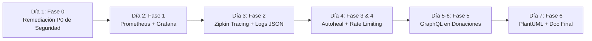

# Plan de Implementación (Revisión v2) — DonaTrack Entrega 7: Observabilidad y Seguridad
**Fecha límite:** 22/11/2026 | **Rama base:** `feature/entrega-7`  
**Estado:** Revisado con correcciones de Red-Team (`plan-critic`) aplicadas (Ida y Vuelta 1 completada)

---

## Resumen Ejecutivo

### Decisión Central: Opción B — GraphQL en `donatrack-donaciones`

Se ratifica la elección de **GraphQL** sobre gRPC por cohesión con la arquitectura actual y menor fricción para el contexto académico:

| Criterio | GraphQL (Opción B) | gRPC (Opción A) |
|---|---|---|
| **Fricción de integración** | **Baja** — Spring for GraphQL nativo en Boot 3.5.x. | **Alta** — stubs protoc, plugins Maven, HTTP/2 forzado en clientes. |
| **Compatibilidad con arquitectura** | **Alta** — Consultas paginadas sobre repositorios JPA y agregaciones de donaciones. | **Media** — Mapeo bidireccional manual de entidades a Protobuf. |
| **Caso de uso de negocio** | **Excelente** — Filtros dinámicos por estado, donante, fechas y categorías con proyección de campos. | **Subóptimo** — No hay streaming continuo de telemetría de alta frecuencia. |
| **Riesgo para tests existentes (284 tests)** | **Mínimo** — Se expone `/graphql` de forma aditiva sin alterar controladores REST. | **Alto** — Refactorización de contratos cliente-servidor inter-módulos. |
| **Tiempo de implementación** | **~1.5 días** | **~3+ días** |

---

### Stack de Observabilidad & Seguridad Consolidado

- **Métricas:** Micrometer + Prometheus (`prom/prometheus:v3.3.0`, `:9090`) + Grafana (`grafana/grafana:12.0.0`, `:3000`).
- **Trazabilidad Distribuida:** Micrometer Tracing + Brave + Zipkin (`openzipkin/zipkin:3.4`, `:9411`), con propagación automática HTTP y RabbitMQ (`setObservationEnabled(true)`).
- **Observabilidad en Web:** Dependencias declaradas en el `pom.xml` padre para que `donatrack-web` (:8080) actúe como Span raíz e inicie el contexto de traza distribuida.
- **Logs Estructurados:** `logback-spring.xml` perfilado: formato estándar coloreado para perfil `local`, y JSON estructurado (`logstash-logback-encoder:8.0`) con `traceId`/`spanId` para perfiles `docker`/`prod`.
- **Monitoreo Proactivo & Autorestart:** Healthchecks con `wget` nativo de Alpine Linux + contenedor supervisor `willfarrell/autoheal` que reinicia automáticamente contenedores insalubres (`unhealthy`).
- **Rate Limiting:** `RateLimitingFilter` en `donatrack-web` con `com.bucket4j:bucket4j-core:8.10.1` + caché LRU con TTL en memoria (`CaffeineCache`) para evitar memory leaks.
- **Seguridad GraphQL:** `/graphql` estrictamente protegido por autenticación JWT / `X-Service-Key`; UI de exploración `/graphiql` restringida a entornos de desarrollo.
- **Remediación P0 de Seguridad:** Corrección rigurosa de IDOR en donaciones/perfiles, saneamiento de fallback M2M, perfilado de endpoints mock de SSO y tipado estricto en auto-configuración de filtros.

---

## 1. Alcance Técnico y Arquitectura de Entrega 7

```mermaid
flowchart TD
    subgraph Observabilidad ["Ecosistema de Observabilidad"]
        PROM["Prometheus (:9090)"]
        GRAF["Grafana (:3000)"]
        ZIPK["Zipkin (:9411)"]
        HEAL["Autoheal Supervisor"]
    end

    subgraph Cliente ["Capa Web & Entrada"]
        WEB["donatrack-web (:8080)\nThymeleaf SSR + BFF\n[RateLimitingFilter - Bucket4j + Caffeine]\n[Span Raíz Micrometer Tracing]"]
    end

    subgraph Backend ["Microservicios de Negocio"]
        AUTH["donatrack-auth (:8004)"]
        DONA["donatrack-donaciones (:8000)\n[REST API + GraphQL Endpoint]"]
        LOGI["donatrack-logistica (:8002)"]
        INCE["donatrack-incentivos (:8001)"]
        NOTI["donatrack-notificaciones (:8003)"]
    end

    subgraph Infra ["Persistencia & Broker"]
        PG[(PostgreSQL 15)]
        MGO[(MongoDB 7.0)]
        RMQ{{RabbitMQ AMQP\n[ObservationEnabled=true]}}
    end

    WEB -->|"HTTP / REST (Trace Context Propagation)"| AUTH
    WEB -->|"HTTP / REST / GraphQL"| DONA
    WEB -->|"HTTP / REST"| LOGI
    DONA -->|Eventos de Dominio| RMQ
    RMQ -->|Consumo Asíncrono| NOTI
    RMQ -->|Consumo Asíncrono| INCE

    PROM -->|"Scrape /actuator/prometheus"| WEB
    PROM -->|"Scrape /actuator/prometheus"| DONA
    PROM -->|"Scrape /actuator/prometheus"| LOGI
    PROM -->|"Scrape /actuator/prometheus"| INCE
    PROM -->|"Scrape /actuator/prometheus"| NOTI
    PROM -->|"Scrape /actuator/prometheus"| AUTH
    GRAF -->|Consulta Métricas| PROM

    WEB -.->|"Spans HTTP"| ZIPK
    DONA -.->|"Spans HTTP / AMQP"| ZIPK
    LOGI -.->|"Spans HTTP"| ZIPK
    NOTI -.->|"Spans AMQP"| ZIPK

    HEAL -.->|"Monitorea Docker Healthchecks"| WEB
    HEAL -.->|"Monitorea Docker Healthchecks"| DONA
```

---

## 2. Plan Detallado de Fases de Implementación

### FASE 0 — Remediación de Vulnerabilidades P0 de Seguridad
**Duración estimada:** 4 horas | **Dependencias:** Ninguna (base obligatoria)

#### Tarea 0.1 — P0-1: Aislamiento Estricto de Mock SSO
- **Archivos:**
  - `donatrack-auth/src/main/java/com/donatrack/auth/infrastructure/adapters/in/api/MockSsoController.java` (Nuevo)
  - `donatrack-auth/src/main/java/com/donatrack/auth/infrastructure/adapters/in/api/AuthController.java` (Modificado)
- **Implementación:**
  1. Extraer los endpoints `/api/auth/sso/codigo` y `/oauth2/authorization/{provider}` a `MockSsoController`, anotado exclusivamente con `@Profile({"local", "test", "dev"})`.
  2. Remover los métodos mock y la bandera de bypass de `AuthController`.
- **Criterio de Aceptación:**
  - En entorno de producción (`spring.profiles.active=prod`), la petición a `/api/auth/sso/codigo` retorna HTTP 404 Not Found.

#### Tarea 0.2 — P0-4: Tipado Seguro en `ServiceSecurityAutoConfiguration`
- **Archivo:** `donatrack-common/src/main/java/com/donatrack/common/infrastructure/security/ServiceSecurityAutoConfiguration.java`
- **Implementación:**
  - Reemplazar la condición frágil por nombre con `@ConditionalOnMissingBean(SecurityFilterChain.class)`. De este modo, microservicios como `donatrack-auth` (que declaran su propia cadena de filtros completa) quedan exentos del filtro M2M genérico sin depender de nombres de bean arbitrarios (`filterChain` vs `securityFilterChain`).
- **Criterio de Aceptación:**
  - `donatrack-auth` y `donatrack-web` inicializan sus cadenas de seguridad personalizadas sin solapamientos ni excepciones de beans duplicados.

#### Tarea 0.3 — P0-5: Validación de Entropía e Inyección Directa de Clave M2M
- **Archivo:** `donatrack-common/src/main/java/com/donatrack/common/infrastructure/security/ServiceSecurityAutoConfiguration.java`
- **Implementación:**
  1. Inyectar directamente el valor de la clave mediante `@Value("${donatrack.internal-api-key:${INTERNAL_API_KEY:donatrack-internal-key-change-in-prod}}") private String internalApiKey;`.
  2. Implementar `@PostConstruct public void validarSeguridadClaveM2M()`:
     ```java
     @PostConstruct
     public void validarSeguridadClaveM2M() {
       boolean esProd = Arrays.asList(environment.getActiveProfiles()).contains("prod");
       String claveInsegura = "donatrack-internal-key-change-in-prod";
       if (esProd && (claveInsegura.equals(internalApiKey) || internalApiKey == null || internalApiKey.length() < 32)) {
         throw new IllegalStateException("CRÍTICO: INTERNAL_API_KEY insegura en producción. Debe poseer al menos 32 caracteres y diferir del valor por defecto.");
       }
       if (claveInsegura.equals(internalApiKey)) {
         log.warn("ADVERTENCIA DE SEGURIDAD: INTERNAL_API_KEY utiliza la clave por defecto. Válido únicamente en entorno local/test.");
       }
     }
     ```
- **Criterio de Aceptación:**
  - En perfil `prod` con clave por defecto, la aplicación aborta el arranque con `IllegalStateException`. En local emite `WARN` y arranca correctamente.

#### Tarea 0.4 — P0-7: Protección Anti-IDOR en Controladores de Dominio
- **Archivos:**
  - `donatrack-common/.../security/JwtClaimsExtractor.java` (Nuevo helper reutilizable)
  - `donatrack-donaciones/.../api/DonacionController.java` (Modificado)
  - `donatrack-auth/.../api/AuthController.java` (Modificado)
- **Implementación Técnica Precisa:**
  1. En `DonacionController.java`, inyectar `HttpServletRequest request` en el método:
     ```java
     @GetMapping("/{id}")
     public ResponseEntity<DonacionResponseDTO> obtenerDonacion(@PathVariable UUID id, HttpServletRequest request)
     ```
  2. En lugar de invocar métodos inexistentes en la entidad `Donacion`, utilizar el método de resolución de dueño existente en el controlador:
     ```java
     UUID idDonanteDueno = resolverPersonaDonanteId(id);
     UUID callerUserId = JwtClaimsExtractor.extraerUserId(request, jwtSecret).orElse(null);
     boolean esAdminOInternal = JwtClaimsExtractor.esAdminOInternalService(request, internalApiKey);

     if (!esAdminOInternal && (idDonanteDueno == null || !idDonanteDueno.equals(callerUserId))) {
       return ResponseEntity.status(HttpStatus.FORBIDDEN).build();
     }
     ```
  3. Aplicar validación análoga en `AuthController` para la consulta y actualización de perfiles (`/api/auth/perfil/{id}`).
- **Criterio de Aceptación:**
  - Un usuario autenticado con rol `DONANTE` recibe HTTP 403 Forbidden al intentar consultar el detalle de una donación perteneciente a otro donante. Un usuario con rol `ADMIN` o con cabecera `X-Service-Key` válida accede sin restricciones.

---

### FASE 1 — Observabilidad Centralizada: Métricas con Prometheus y Grafana
**Duración estimada:** 1 día | **Dependencias:** Fase 0

#### Tarea 1.1 — Declaración Centralizada de Dependencias de Observabilidad
- **Archivo:** `pom.xml` (Parent POM raíz)
- **Implementación:**
  - Agregar en el bloque `<dependencies>` general del parent POM (para que **todos** los submódulos, incluyendo explícitamente `donatrack-web` y `donatrack-common`, hereden el soporte):
    ```xml
    <dependency>
        <groupId>io.micrometer</groupId>
        <artifactId>micrometer-registry-prometheus</artifactId>
    </dependency>
    ```
- **Criterio de Aceptación:**
  - Tanto los microservicios backend como `donatrack-web` exponen el endpoint `/actuator/prometheus`.

#### Tarea 1.2 — Exposición Unificada de Actuator
- **Archivos:** `application.properties` / `application.yml` de los 6 servicios.
- **Configuración:**
  ```properties
  management.endpoints.web.exposure.include=health,info,prometheus,metrics
  management.endpoint.prometheus.access=unrestricted
  management.endpoint.health.show-details=when-authorized
  management.metrics.tags.application=${spring.application.name}
  ```

#### Tarea 1.3 — Aprovisionamiento de Prometheus y Grafana en Docker Compose
- **Archivos:**
  - `compose.yaml`
  - `monitoring/prometheus/prometheus.yml`
  - `monitoring/grafana/provisioning/datasources/prometheus.yml`
  - `monitoring/grafana/provisioning/dashboards/dashboards.yml`
  - `monitoring/grafana/provisioning/dashboards/donatrack-overview.json`
- **Configuración:**
  - Scrape configs en `prometheus.yml` apuntando a: `donaciones:8000`, `incentivos:8001`, `logistica:8002`, `notificaciones:8003`, `auth:8004` y `web:8080`.
  - Dashboard pre-aprovisionado en Grafana con métricas de throughput (RPS), latencia p95 y consumo de Heap JVM.
- **Criterio de Aceptación:**
  - Al ejecutar `docker compose up -d prometheus grafana`, Prometheus muestra los 6 targets en estado `UP` y Grafana muestra datos en vivo en `http://localhost:3000`.

---

### FASE 2 — Trazabilidad Distribuida (Zipkin) y Logging Estructurado
**Duración estimada:** 1 día | **Dependencias:** Fase 1

#### Tarea 2.1 — Inclusión de Trazas Distribuidas en Parent POM
- **Archivo:** `pom.xml` (Parent POM raíz)
- **Implementación:**
  - Incorporar en `<dependencies>` general:
    ```xml
    <dependency>
        <groupId>io.micrometer</groupId>
        <artifactId>micrometer-tracing-bridge-brave</artifactId>
    </dependency>
    <dependency>
        <groupId>io.zipkin.reporter2</groupId>
        <artifactId>zipkin-reporter-brave</artifactId>
    </dependency>
    <dependency>
        <groupId>net.logstash.logback</groupId>
        <artifactId>logstash-logback-encoder</artifactId>
        <version>8.0</version>
    </dependency>
    ```
  - Al estar en el parent, `donatrack-web` inicia el span raíz de cada interacción de usuario y propaga las cabeceras B3 / traceparent hacia los servicios satélites.

#### Tarea 2.2 — Configuración de Muestreo y Desactivación en Tests
- **Archivos:** `application.properties` / `application.yml` de todos los módulos.
- **Configuración en Perfil Base:**
  ```properties
  management.tracing.sampling.probability=1.0
  management.zipkin.tracing.endpoint=${ZIPKIN_ENDPOINT:http://localhost:9411/api/v2/spans}
  ```
- **Configuración en `application-test.properties`:**
  ```properties
  management.tracing.sampling.probability=0.0
  ```
  (Garantiza que la suite existente de 284 tests no sufra degradación ni intente conectar a Zipkin en CI/CD local).

#### Tarea 2.3 — Propagación Nativa en RabbitMQ
- **Archivo:** `donatrack-common/.../config/RabbitMQCommonConfig.java`
- **Implementación:**
  - Activar el soporte de observaciones de Micrometer en el productor y en el consumidor:
    ```java
    rabbitTemplate.setObservationEnabled(true);
    factory.setObservationEnabled(true);
    ```
- **Criterio de Aceptación:**
  - Cuando una donación es registrada y se publica un evento a RabbitMQ, la traza iniciada en `donatrack-web` o `donatrack-donaciones` continúa en el procesamiento asíncrono de `donatrack-notificaciones` en Zipkin.

#### Tarea 2.4 — Configuración Perfilada de Logs (JSON vs Human-Readable)
- **Archivo:** `donatrack-common/src/main/resources/logback-spring.xml`
- **Implementación:**
  - Usar perfiles de Spring para no arruinar la experiencia de desarrollo en consola:
    ```xml
    <configuration>
        <springProfile name="local,test">
            <appender name="CONSOLE" class="ch.qos.logback.core.ConsoleAppender">
                <encoder>
                    <pattern>%d{HH:mm:ss.SSS} [%thread] %highlight(%-5level) %cyan(%logger{36}) [traceId=%X{traceId:-}] - %msg%n</pattern>
                </encoder>
            </appender>
            <root level="INFO"><appender-ref ref="CONSOLE"/></root>
        </springProfile>
        <springProfile name="prod,docker">
            <appender name="JSON_CONSOLE" class="ch.qos.logback.core.ConsoleAppender">
                <encoder class="net.logstash.logback.encoder.LogstashEncoder">
                    <customFields>{"service":"${spring.application.name}"}</customFields>
                </encoder>
            </appender>
            <root level="INFO"><appender-ref ref="JSON_CONSOLE"/></root>
        </springProfile>
    </configuration>
    ```

---

### FASE 3 — Monitoreo Proactivo y Autorestart ante Fallos
**Duración estimada:** 4 horas | **Dependencias:** Fase 1

#### Tarea 3.1 — Healthchecks Compatibles con Alpine Linux
- **Archivo:** `compose.yaml`
- **Implementación:**
  - Dado que las imágenes son `eclipse-temurin:21-jre-alpine`, usar `wget` nativo en lugar de intentar instalar paquetes con `apt-get`:
    ```yaml
    healthcheck:
      test: ["CMD-SHELL", "wget --no-verbose --tries=1 --spider http://localhost:8080/actuator/health || exit 1"]
      interval: 30s
      timeout: 10s
      retries: 3
      start_period: 60s
    ```

#### Tarea 3.2 — Supervisor de Autorestart con `autoheal`
- **Archivo:** `compose.yaml`
- **Implementación:**
  - Incorporar el supervisor `willfarrell/autoheal`:
    ```yaml
    autoheal:
      image: willfarrell/autoheal:latest
      container_name: autoheal_donatrack
      restart: unless-stopped
      environment:
        - AUTOHEAL_CONTAINER_LABEL=autoheal
        - AUTOHEAL_INTERVAL=10
        - AUTOHEAL_START_PERIOD=60
      volumes:
        - /var/run/docker.sock:/var/run/docker.sock
    ```
  - Añadir la etiqueta `labels: [ "autoheal=true" ]` en todos los servicios de negocio de DonaTrack.
- **Criterio de Aceptación:**
  - Si una aplicación sufre un bloqueo o responde status DOWN/unhealthy, `autoheal` detecta el estado y reinicia automáticamente el contenedor sin intervención manual.

---

### FASE 4 — Rate Limiting Robusto en `donatrack-web`
**Duración estimada:** 4 horas | **Dependencias:** Fase 1

#### Tarea 4.1 — Dependencias Correctas en `donatrack-web/pom.xml`
- **Implementación:**
  - Usar la coordenada Maven moderna oficial y sumar Caffeine para mitigación de DoS/Memory Leak:
    ```xml
    <dependency>
        <groupId>com.bucket4j</groupId>
        <artifactId>bucket4j-core</artifactId>
        <version>8.10.1</version>
    </dependency>
    <dependency>
        <groupId>com.github.ben-manes.caffeine</groupId>
        <artifactId>caffeine</artifactId>
    </dependency>
    ```

#### Tarea 4.2 — Implementación de `RateLimitingFilter` con Evicción de Memoria
- **Archivo:** `donatrack-web/src/main/java/com/donatrack/web/security/RateLimitingFilter.java`
- **Implementación:**
  1. Configurar caché Caffeine con TTL:
     ```java
     private final Cache<String, Bucket> bucketCache = Caffeine.newBuilder()
         .expireAfterAccess(10, TimeUnit.MINUTES)
         .maximumSize(10_000)
         .build();
     ```
  2. Extraer IP cliente saneando `X-Forwarded-For` (tomando la primera IP de la lista o fallback a `getRemoteAddr()`).
  3. Excluir rutas de estáticos (`/css/**`, `/js/**`, `/assets/**`, `/favicon.ico`) y `/actuator/**`.
  4. Si excede el cupo: retornar HTTP 429 Too Many Requests con payload JSON estructurado `{"error":"RATE_LIMIT_EXCEEDED", "mensaje":"Demasiadas solicitudes. Reintente en un minuto."}`.
  5. En éxito: añadir cabeceras `X-Rate-Limit-Remaining`.
- **Criterio de Aceptación:**
  - Test unitario con MockMvc que simule ráfagas de peticiones verificando HTTP 429 en la petición $N+1$.

---

### FASE 5 — Interfaz Web Service GraphQL en `donatrack-donaciones`
**Duración estimada:** 1.5 días | **Dependencias:** Fase 0

#### Tarea 5.1 — Dependencias y Schema GraphQL
- **Archivos:**
  - `donatrack-donaciones/pom.xml`: `spring-boot-starter-graphql` y `spring-graphql-test`.
  - `donatrack-donaciones/src/main/resources/graphql/donaciones.graphqls`:
    ```graphql
    type Query {
        donaciones(
            estado: EstadoDonacion
            idDonante: ID
            categoriaId: ID
            pagina: Int = 0
            tamanio: Int = 10
        ): DonacionPage!
        donacion(id: ID!): Donacion
        estadisticasDonante(idDonante: ID!): EstadisticasDonante!
    }

    enum EstadoDonacion {
        PENDIENTE
        EN_DEPOSITO
        ASIGNADA
        EN_CAMINO
        ENTREGADA
        VENCIDA
        CANCELADA
    }

    type DonacionPage {
        contenido: [Donacion!]!
        totalElementos: Int!
        totalPaginas: Int!
        paginaActual: Int!
    }

    type Donacion {
        id: ID!
        descripcion: String
        estado: EstadoDonacion!
        fechaCreacion: String!
        items: [ItemDonacion!]!
    }

    type ItemDonacion {
        id: ID!
        nombre: String!
        cantidad: Int!
        categoria: String
    }

    type EstadisticasDonante {
        idDonante: ID!
        totalDonaciones: Int!
        donacionesEntregadas: Int!
    }
    ```

#### Tarea 5.2 — Repositorio Optimizado (Sin Antipatrón $N+1$)
- **Archivo:** `donatrack-donaciones/src/main/java/com/donatrack/donaciones/infrastructure/adapters/out/persistence/jpa/DonacionJpaRepository.java`
- **Implementación:**
  - Agregar query con `LEFT JOIN FETCH` para evitar el problema de $N+1$ queries al solicitar ítems en GraphQL:
    ```java
    @Query("SELECT DISTINCT d FROM DonacionJpaEntity d LEFT JOIN FETCH d.items WHERE (:estado IS NULL OR d.estado = :estado)")
    Page<DonacionJpaEntity> buscarConFiltrosPaginados(@Param("estado") EstadoDonacionJpa estado, Pageable pageable);
    ```
  - Imponer un límite de seguridad en el controlador: `int tamanioSeguro = Math.min(tamanio, 50);`.

#### Tarea 5.3 — Controlador GraphQL Seguro
- **Archivo:** `donatrack-donaciones/src/main/java/com/donatrack/donaciones/infrastructure/adapters/in/graphql/DonacionGraphQLController.java`
- **Seguridad:**
  - `/graphql` permanece bajo el filtro `ServiceSecurityFilter` (requiere autenticación JWT / `X-Service-Key`).
  - GraphiQL (`/graphiql`) habilitado únicamente en perfiles `local` y `dev`.
- **Criterio de Aceptación:**
  - Suite de pruebas con `@GraphQlTest` verificando filtros dinámicos y proyección de campos.

---

### FASE 6 — Actualización del Diagrama PlantUML y Documentación de Cátedra
**Duración estimada:** 3 horas | **Dependencias:** Fases 1 a 5

#### Tarea 6.1 — Actualización de `DonaTrack-Diagrama-Componentes-y-Despliegue.puml`
- Reflejar la arquitectura real:
  - Eliminar SPA Vite :3000 obsoleta.
  - Representar `donatrack-web` (:8080) con SSR Thymeleaf, Rate Limiting (Bucket4j) y Tracing raíz.
  - Incorporar el cluster de observabilidad: Prometheus (:9090), Grafana (:3000), Zipkin (:9411) y Autoheal.
  - Reflejar el endpoint `/graphql` en el componente de donaciones.
  - Asegurar compilación limpia en PlantUML.

#### Tarea 6.2 — Documento de Decisiones de Entrega 7
- **Archivo:** `docs/notas_y_borradores/entrega-7-observabilidad-seguridad.md`
- Documentar las justificaciones de diseño (trade-offs GraphQL vs gRPC, Bucket4j vs Redis, Brave vs OTel).

---

## 3. Matriz de Riesgos Mitigados (Red-Team Audit)

| Riesgo Original | Nivel | Mitigación Incorporada en esta Revisión |
|---|---|---|
| **Inexistencia de métodos y campos en código de seguridad** | **P0** | Se corrigieron las llamadas usando `resolverPersonaDonanteId`, inyección de `request` y validación directa en properties. |
| **Fallo en Docker Build por Alpine Linux** | **P0** | Se sustituyó `apt-get` por `wget` nativo de Alpine en los healthchecks. |
| **`donatrack-web` ciego en observabilidad** | **P0** | Dependencias de Micrometer y Logstash subidas al Parent POM para cobertura integral. |
| **Backdoor público en `/graphql`** | **P0** | `/graphql` requiere autenticación estricta; `/graphiql` aislado a entornos dev. |
| **Coordenadas obsoletas de Bucket4j** | **P0** | Actualizado a `com.bucket4j:bucket4j-core:8.10.1`. |
| **Memory leak en Rate Limiting** | **P1** | Incorporación de caché Caffeine con TTL y evicción LRU (`maximumSize(10000)`). |
| **Falso autorestart en Docker** | **P1** | Integración del contenedor supervisor `willfarrell/autoheal` montando `/var/run/docker.sock`. |
| **Antipatrón $N+1$ en GraphQL** | **P1** | Implementación de `LEFT JOIN FETCH` y tope máximo `maxPageSize=50`. |

---

## 4. Cronograma de Implementación



- **Viernes 14/11:** Fase 0 completada (tests en verde con P0 subsanados).
- **Sábado 15/11:** Fase 1 completada (Prometheus + Grafana en Docker).
- **Domingo 16/11:** Fase 2 completada (Trazas en Zipkin y logs estructurados).
- **Lunes 17/11:** Fase 3 y 4 completadas (Autoheal + Rate Limiting verificado).
- **Martes 18/11 - Miércoles 19/11:** Fase 5 completada (GraphQL operativo con tests).
- **Jueves 20/11:** Fase 6 completada (Diagrama PlantUML actualizado).
- **Viernes 21/11 - Sábado 22/11:** Buffer de pruebas E2E y cierre formal de entrega.

